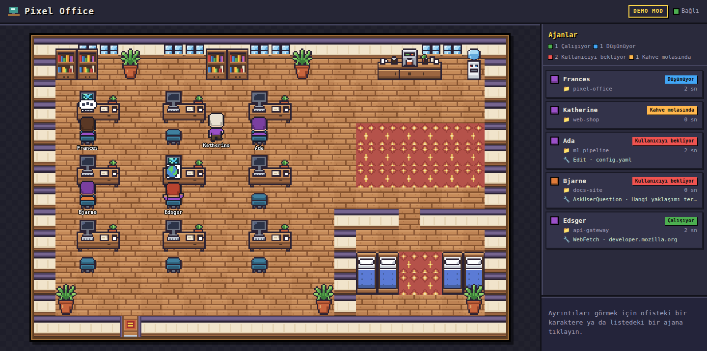
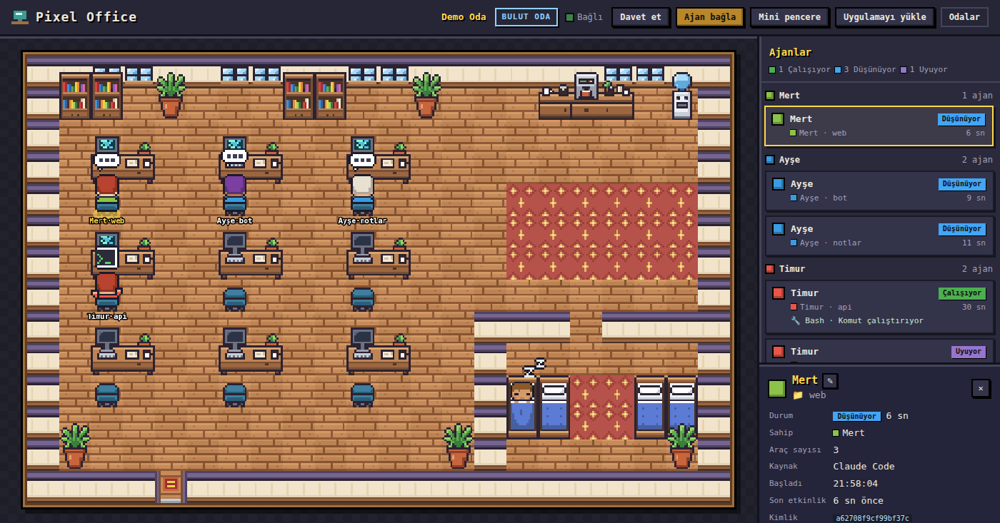

# Pixel Office

Pixel Office, tarayıcıda çalışan pixel-art bir sanal ofistir. Bilgisayarınızda çalışan her **Claude Code** oturumu ve alt-ajanı, ofiste küçük bir karakter olarak görünür. Ajan çalışırken masasında klavyeye yazar, düşünürken başının üstünde "..." balonu çıkar. Sizden onay beklediğinde kırmızı bir "!" yanıp söner. Turu bittiğinde kahve makinesine gider, uzun süre sessiz kalırsa yatakta uyur. Oturum kapanınca kapıdan çıkar.

İki şekilde kullanılır:

- **Yerel mod** (v1): `python3 server.py`. Yalnızca sizin bilgisayarınızdaki oturumlar görünür. Kurulum yok, hesap yok.
- **Bulut Ofis** (v2): Vercel'e ücretsiz yüklediğiniz bir site. Arkadaşlarınız tek bir bağlantıyla aynı ofise girer ve birbirlerinin ajanlarını canlı görür. Masaüstü uygulaması olarak yüklenebilir ve her zaman üstte duran bir mini pencerede açılabilir.
- **Ajan Kontrol Merkezi** (v3, deneme): ofisten, telefondan bile, kendi bilgisayarınızdaki Claude Code ve Ollama ajanlarına uçtan uca şifreli görev verirsiniz; token sayacı, bütçeler ve çalışma ortamlarını uzaktan başlatma/durdurma ile. Bkz. [Ajan Kontrol Merkezi (v3, deneme)](#ajan-kontrol-merkezi-v3-deneme).



*Yerel mod, demo. Masalarda araç ikonu (çalışıyor), "..." (düşünüyor) ve "!" (kullanıcıyı bekliyor) balonları var, kahve makinesinin önünde mola veren bir ajan duruyor. Sağda durum sayaçları ve ajan listesi var. Bir karaktere tıklayınca ayrıntılar açılır.*

> **English summary:** Pixel Office is a zero-dependency (Python stdlib + vanilla JS) web app that shows AI coding agents as pixel-art office workers: typing at a desk while working, "..." while thinking, a blinking "!" while waiting for you, a coffee break when idle, sleeping when done. **Local mode:** `python3 server.py` watches your Claude Code transcripts under `~/.claude/projects` (read-only) and serves http://localhost:8765 (`--demo` for fake agents). **Cloud Office (v2):** deploy the repo to Vercel Hobby (GitHub import, no build settings) with the free Upstash Redis integration and a `PIXEL_SECRET` env var; create a room, share the invite link, and each friend runs one command that installs a privacy-filtering Claude Code hook (Python or built-in Windows PowerShell). Only state, tool name, a fixed label, the project folder name and the owner name ever leave a machine. Local AI agents (Ollama, LM Studio, aider, …) can report too via `pixel_agent.py`. Installable PWA with an always-on-top mini window (Document Picture-in-Picture). **Agent Control Center (v3, trial):** a stdlib-only connector (`pixel-connector`, Python ≥ 3.8) on your machine plus a Cloudflare Worker relay let your paired browsers and phone send prompts to Claude Code (headless, never `bypassPermissions`, folder allow-list, permission profiles) or Ollama, end-to-end encrypted (P-256 ECDH, HKDF, AES-256-GCM; Vercel and the relay only see ciphertext), with live token counters, budgets and remote start/stop of local runtimes. See the v3 section and the deploy checklist below. MIT licensed.

## İçindekiler

1. [Gereksinimler](#gereksinimler)
2. [Yerel mod](#yerel-mod)
3. [Bulut Ofis (v2)](#bulut-ofis-v2)
   - [Adım adım dağıtım](#adım-adım-dağıtım-vercel--upstash)
   - [Arkadaşlar nasıl katılır](#arkadaşlar-nasıl-katılır)
   - [Uygulama olarak yükleme ve mini pencere](#uygulama-olarak-yükleme-ve-mini-pencere)
   - [Claude Code ve yerel yapay zeka ajanlarını bağlama](#claude-code-ve-yerel-yapay-zeka-ajanlarını-bağlama)
   - [Gizlilik ve güvenlik](#gizlilik-ve-güvenlik)
   - [Ücretsiz plan limitleri](#ücretsiz-plan-limitleri)
4. [Ajan Kontrol Merkezi (v3, deneme)](#ajan-kontrol-merkezi-v3-deneme)
   - [Bağlayıcıyı kurma](#bağlayıcıyı-kurma) · [Güncelleme](#bağlayıcıyı-güncelleme) · [Eşleştirme](#masaüstü-ve-telefonu-eşleştirme) · [Görev verme](#görev-verme) · [Bütçeler](#token-göstergesi-ve-bütçeler) · [Patron Odası](#patron-odası-bağlayıcı-380) · [Sorun giderme (v3)](#sorun-giderme-v3)
   - [Yayına alma kontrol listesi (v3)](#yayına-alma-kontrol-listesi-v3)
5. [Ajanları yeniden adlandırma](#ajanları-yeniden-adlandırma)
6. [Durumlar nasıl belirleniyor?](#durumlar-nasıl-belirleniyor)
7. [Proje yapısı](#proje-yapısı)
8. [Testler](#testler)
9. [Sorun giderme](#sorun-giderme)
10. [Bilinen sınırlamalar](#bilinen-sınırlamalar)

## Gereksinimler

- **Python 3.11 veya üzeri** (yerel sunucu ve geliştirme sunucusu için). Proje yalnızca standart kütüphaneyi kullanır, `pip install` gerekmez. 3.11 alt sınırı `enum.StrEnum` ve `datetime.fromisoformat` içindeki `Z` desteğinden gelir. Geliştirme ve testler Python 3.14 ile yapıldı. Vercel'de Python 3.12 kullanılır (`.python-version`).
- Arkadaşların bilgisayarlarındaki kanca istemcisi **Python 3.8+** ister. Python yoksa Windows'la gelen **PowerShell 5.1** yeterlidir.
- **Güncel bir tarayıcı** (Chrome, Edge, Firefox, Safari). Mini pencere en iyi Chrome ve Edge'de çalışır.

Node.js, derleme adımı, CDN ya da harici resim **yoktur**. Tüm sprite'lar JavaScript içinde prosedürel olarak üretilir.

## Yerel mod

```bash
cd Pixel                     # depoyu klonladığınız klasör
python3 server.py            # gerçek Claude Code oturumlarını izler (salt-okunur)
python3 server.py --demo     # gerçek veri olmadan, sahte ajanlarla demo
```

Ardından tarayıcıda **http://localhost:8765** adresini açın. Durdurmak için `Ctrl+C` yeterli.

| Seçenek | Varsayılan | Açıklama |
|---|---|---|
| `--demo` | kapalı | Gerçek transcript'ler yerine 5 sahte ajan çalıştırır. Ajanlar tüm durumlar arasında döner, biri alt-ajan başlatır, uyuyan ajanlar çıkıp yerlerine yenileri gelir. |
| `--port PORT` | `8765` | HTTP portu |
| `--host HOST` | `127.0.0.1` | Dinlenecek adres. Ağdan erişmek için `0.0.0.0` verebilirsiniz, ama transcript özetleri o ağdaki herkese açılır. |
| `--projects-dir DİZİN` | `~/.claude/projects` | İzlenecek Claude Code proje dizini |
| `--poll SN` | `1.0` | Dosya yoklama aralığı (saniye) |
| `--names-file DOSYA` | `~/.local/share/pixel-office/names.json` | Arayüzden verilen adların saklandığı dosya (ilk ad değişikliğinde oluşur) |
| `--write-key ANAHTAR` | yok | `POST /api/status` ve ad değişikliği için anahtar. Loopback dışında dinlerken zorunludur (verilmezse üretilir). |
| `-v`, `--verbose` | kapalı | Ayrıntılı günlük (hangi oturumların izlendiği vb.) |
| `--version` | | Sürümü yazdırır |

Örnek: `python3 server.py --port 9000 --projects-dir ~/.claude/projects`

DNS rebinding koruması: sunucu yalnızca IP adresiyle, `localhost` ile, bilgisayarın kendi adıyla (`ad`, `ad.local`) ya da `--host` ile verilen adla gelen istekleri kabul eder; başka bir adla gelen istek `421` alır. Başka bir adla (örneğin Tailscale adı) açıyorsanız adı ekleyin: `PIXEL_OFFICE_ALLOWED_HOSTS=pc.tailnet.ts.net python3 server.py --host 0.0.0.0` (virgülle birden çok ad).

Üst çubukta mod (**CANLI MOD** / **DEMO MOD**) ve bağlantı durumu (**Bağlı** / **Yeniden bağlanıyor…**) yer alır. Sunucu yeniden başlatılırsa sayfa kendiliğinden yeniden bağlanır. Adrese `?debug` eklerseniz FPS'i ve karakter durumlarını gösteren bir hata ayıklama katmanı açılır.

Yerel sunucu da bulutla aynı `POST /api/status` ucunu sunar. Böylece Ollama, aider ya da kendi betikleriniz de yerel ofiste görünebilir (bkz. [`docs/INTEGRATIONS.md`](docs/INTEGRATIONS.md)).

## Bulut Ofis (v2)



*Bulut odası. Her karakterin üstünde `sahip·proje` yazar, her sahibin kendi gömlek rengi vardır. Sağdaki liste sahibe göre gruplanır. Üst çubukta Davet et, Ajan bağla, Mini pencere ve Uygulamayı yükle düğmeleri var.*

Nasıl çalışır, kısaca:

- Site Vercel'in ücretsiz **Hobby** planında çalışır. `web/` klasörü statik dosya olarak, `api/*.py` dosyaları Python fonksiyonu olarak yayınlanır.
- Odaların durumu ücretsiz **Upstash Redis** veritabanında tutulur.
- Tarayıcılar odayı birkaç saniyede bir yoklar (oda aktifken 10 sn, sakinken 30 sn). Yeni açılan boş bir odada ve "Ajan bağla" penceresi açıkken 5 sn'de bir yoklanır, böylece ilk ajan birkaç saniyede görünür.
- Her arkadaşın bilgisayarındaki küçük bir kanca, Claude Code olaylarını **orada** süzer ve yalnızca durumu gönderir.

### Adım adım dağıtım (Vercel + Upstash)

Bunları **bir kez**, ofisi kuracak kişi yapar. Toplam süre yaklaşık 15 dakika. Kredi kartı gerekmez.

**1. git'i kurun ve projeyi GitHub'a yükleyin.**

```bash
sudo apt install git                       # Ubuntu/Debian. macOS: xcode-select --install
git config --global user.name "Adınız"
git config --global user.email "eposta@ornek.com"
```

[github.com](https://github.com) adresinde (gerekirse ücretsiz hesap açın) sağ üstteki **+ → New repository** ile yeni bir depo oluşturun:
- Ad: örneğin `pixel-office`.
- **Private** seçebilirsiniz, Vercel özel depoları da içe aktarır.
- README, .gitignore ve lisans **eklemeyin**, bunlar projede zaten var.

Depoyu **kişisel hesabınızda** açın. Vercel'in ücretsiz planı GitHub organizasyonlarına ait depoları içe aktaramaz.

Sonra proje klasöründe:

```bash
cd Pixel
git init
git add .
git commit -m "Pixel Office"
git branch -M main
git remote add origin https://github.com/<kullanıcı-adınız>/pixel-office.git
git push -u origin main
```

GitHub `push` sırasında parola yerine bir **token** ister. GitHub → Settings → Developer settings → Personal access tokens bölümünden `repo` yetkili bir token oluşturup parola yerine onu yapıştırın. Alternatif olarak GitHub Desktop'ı ya da depo sayfasındaki **"uploading an existing file"** bağlantısını kullanabilirsiniz. Dosyaları sürükleyip bırakırken `.gitignore`, `.vercelignore` ve `.python-version` gibi gizli dosyaları da eklemeyi unutmayın.

`.gitignore` sayesinde `__pycache__`, `names.json` (yerel oturum adları), `.vercel` ve `.env` dosyaları depoya girmez.

**2. Vercel'de projeyi içe aktarın.**

1. [vercel.com](https://vercel.com) adresinde **GitHub ile** ücretsiz hesap açın (Hobby planı).
2. **Add New… → Project** seçin ve listede `pixel-office` deposunu bulup **Import** deyin. Depo görünmüyorsa "Adjust GitHub App Permissions" ile Vercel'e o depoya erişim verin.
3. Ayarlara **dokunmayın**: Framework Preset "Other", Root Directory `./`, Build ve Install Command boş kalabilir. Gerekli her şey `vercel.json` içinde tanımlı (statik dosyalar `web/`, fonksiyonlar `api/`, bölge Frankfurt).
4. **Deploy** deyin. İlk dağıtım yaklaşık bir dakika sürer. Henüz veritabanı olmadığı için oda oluşturma çalışmaz, sıradaki adımlar bunu tamamlar.

**3. Upstash Redis'i ekleyin (Vercel Marketplace).**

1. Vercel'de projenizi açın → üstteki **Storage** sekmesi → **Create Database** (ya da **Browse Marketplace**).
2. **Upstash → Upstash for Redis** seçin.
3. Plan **Free**, bölge **Frankfurt (eu-central-1)** olsun (fonksiyonlarla aynı yer, daha hızlı).
4. Oluşturduktan sonra veritabanını projeye bağlayın (**Connect Project**, tüm ortamlar seçili kalsın).

Vercel bağlantı bilgilerini (`KV_REST_API_URL` / `KV_REST_API_TOKEN` ya da `UPSTASH_REDIS_REST_URL` / `UPSTASH_REDIS_REST_TOKEN`) ortam değişkeni olarak kendisi ekler. Kod iki adlandırmayı da tanır, sizin bir şey yazmanız gerekmez.

**4. Ortam değişkenlerini girin.**

Önce gizli anahtarı kendi bilgisayarınızda üretin:

```bash
python3 -c "import secrets;print(secrets.token_urlsafe(32))"
```

Çıkan metni kopyalayın. Vercel'de **Settings → Environment Variables** bölümüne gidin ve şunları ekleyin (Environment: en azından Production):

| Ad | Değer | Zorunlu mu? |
|---|---|---|
| `PIXEL_SECRET` | yukarıda ürettiğiniz metin (en az 32 karakter) | **Evet** |
| `PIXEL_CREATE_TOKEN` | oda oluşturmak için bir parola, ör. `kahve-2026-oda` | Önerilir |
| `PIXEL_PUBLIC_URL` | `https://<proje>.vercel.app` (davet bağlantılarında hep bu adres kullanılır) | İsteğe bağlı |

> ⚠️ **`PIXEL_SECRET`'i bir kez belirleyin ve sonra değiştirmeyin.** Tüm davet bağlantılarındaki yazma anahtarları bundan türetilir. Değiştirirseniz herkesin kurulumu bozulur ve bağlantılar yeniden dağıtılmalıdır. Bu değeri kimseyle paylaşmayın ve GitHub'a yazmayın.

`PIXEL_CREATE_TOKEN` tanımlıysa sitede oda oluşturmak için bu parola sorulur. Tanımlı değilse adresi bilen herkes oda oluşturabilir (yine de saatte 5 oda ile sınırlıdır).

**5. Yeniden dağıtın ve test edin.**

Ortam değişkenleri yalnızca **yeni** dağıtımlarda geçerli olur:
1. **Deployments** sekmesi → en üstteki dağıtımın **⋯** menüsü → **Redeploy**.
2. Bittikten sonra `https://<proje>.vercel.app/api/health` adresini açın. Şunu görmelisiniz:

   ```json
   {"ok":true,"version":"2.0.0","storage":"upstash","storageOk":true}
   ```

   `"storage":"unconfigured"` görürseniz 3. adımı, oda oluştururken hata alırsanız 4. adımı kontrol edin.
3. `https://<proje>.vercel.app` adresini açın, adınızı yazıp **Oda oluştur** deyin.
4. Açılan **Davet et** penceresinden katılma bağlantısını kopyalayın.
5. **Ajan bağla** penceresindeki komutu kendi bilgisayarınızda çalıştırın ve Claude Code'u yeniden başlatın. Birkaç saniye içinde ofiste "Kurulum testi" karakteri, sonra Claude Code oturumunuz görünür.

Hep **production** adresini (`<proje>.vercel.app` ya da kendi alan adınız) kullanın. Vercel'in "preview" dağıtım adresleri ücretsiz planda varsayılan olarak giriş ister ve arkadaşlarınız açamaz.

Sonraki güncellemeler için `git push` yeterlidir, Vercel her push'ta yeniden dağıtır. Yeni sürüm yayımlarken `web/sw.js` içindeki `VERSION` değerini ve `web/js/cloud.js` içindeki `APP_VERSION` değerini birlikte artırın (testler ikisinin aynı olmasını denetler); böylece yüklü uygulamalar yeni dosyaları hemen alır, açık kalmış eski sekmelerde "Yeni sürüm hazır — Yenile" uyarısı çıkar.

### Arkadaşlar nasıl katılır

1. Arkadaşınız davet bağlantısını açar (`https://<proje>.vercel.app/?room=…#key=…`). Anahtar tarayıcıya kaydedilir ve adres çubuğundan silinir.
2. **Ajan bağla** düğmesine basar, adını yazar ve işletim sistemine uygun tek satırlık komutu kopyalayıp terminalde çalıştırır:
   - **macOS / Linux:** `curl … | sh -s -- …` (Python 3.8+ gerekir, yoksa `pwsh` kullanılır).
   - **Windows:** PowerShell ya da Komut İstemi'nde `powershell … irm …/install.ps1 …`. **Python gerekmez.**
3. Açık Claude Code oturumlarını yeniden başlatır. Hepsi bu.

Komutu çalıştırmadan önce betiği okumak isteyenler için pencerede `install.sh` / `install.ps1` bağlantıları vardır. Kurulum `~/.claude/settings.json` dosyasının bir kez yedeğini alır (`settings.json.pixel-backup`), başka kancalara dokunmaz, tekrar çalıştırılabilir ve kaldırılabilir:

```bash
python3 ~/.pixel-office/pixel_hook.py doctor      # her şey yolunda mı?
python3 ~/.pixel-office/pixel_hook.py uninstall   # yalnızca Pixel Office kancalarını kaldırır
```

**Sadece izleme bağlantısı** (`#key=` olmadan) ile açılan oda yalnızca izlenebilir. Ajan bağlanamaz, adlar değiştirilemez. Üst çubukta "Yalnızca izleme" rozeti, ajan listesinin üstünde de kısa bir açıklama görünür. Ekranda göstermek ya da merak eden birine vermek için bunu kullanın.

### Uygulama olarak yükleme ve mini pencere

- **Uygulamayı yükle:** Chrome ve Edge'de odadaki **Uygulamayı yükle** düğmesi (ya da adres çubuğundaki yükleme simgesi) Pixel Ofis'i ayrı bir masaüstü penceresi olarak yükler. Uygulama açılınca son oda doğrudan açılır. Android'de "Ana ekrana ekle", iPhone/iPad'de Safari'de **Paylaş → Ana Ekrana Ekle** kullanılır.
- **Mini pencere:** **Mini pencere** düğmesi ofisi küçük, **her zaman üstte duran** bir pencerede açar (Chrome/Edge 116+, Firefox 151+). Pencereyi bir kez ekranın sağ altına sürükleyin; tarayıcı genellikle konumu hatırlar. Ana pencereyi küçültebilirsiniz, mini pencere canlı kalır. Mini pencere kapanınca ofis ana pencereye döner.
- Safari ve eski tarayıcılarda bunun yerine sağ alta yerleşen küçük bir açılır pencere açılır. Bu pencere her zaman üstte kalmaz.
- Sekme gizliyse ve mini pencere de kapalıysa yoklama 30 sn sonra durur. Bu, ücretsiz kotayı korur.

### Görsel efektler, ses ve maskot kedi

- **Parçacık efektleri:** Ajanlar çalışırken masalarda küçük klavye kıvılcımları/parçacıkları, kahve molasında fincandan yükselen buhar/kahve parçacıkları ve dinlenme odasında uyurken Zzz parçacıkları canlandırılır.
- **Ortam aydınlatması:** Günün saatine göre gün batımı, gece tonları, pencerelerden parlayan yıldızlar ve ofis içi yumuşak aydınlatma geçişleri uygulanır.
- **Maskot kedi (`mascot-cat`):** Ofis zemininde serbestçe dolaşan, mola veren ajanların yanına giden veya dinlenme köşesinde kıvrılıp uyuyan pixel-art bir ofis kedisi bulunur.
- **Web Audio API & Chiptune sesler:** 8-bit chiptune tarzı sentezleyici ile klavye tıkırtıları, kahve fokurtusu, uyku mırıltıları ve görev tamamlama zil sesi üretilir.
- **🔊/🔇 Düğmesi:** Arayüzdeki hoparlör düğmesiyle tüm sesler açılıp kapatılabilir (varsayılan olarak **kapalıdır** / sessiz mod).
- **Erişilebilirlik:** Sistem düzeyinde `prefers-reduced-motion: reduce` ayarı açıksa parçacık efektleri ve hızlı animasyonlar otomatik olarak kapatılır veya yumuşatılır.

### Claude Code ve yerel yapay zeka ajanlarını bağlama

- **Claude Code:** yukarıdaki tek satırlık kurulum yeterli.
- **Yerel yapay zeka ajanları** (Ollama, LM Studio, llama.cpp, aider, Open Interpreter, kendi betikleriniz): `pixel_agent.py` bir kütüphane, bir komut sarmalayıcısı (`pixel-run`) ve akışı bozmayan bir OpenAI/Ollama ara sunucusu (`pixel-proxy`) içerir. Hazır komutlar "Ajan bağla → Genel API" sekmesinde, gerçek adres ve anahtarla doldurulmuş olarak gösterilir.
- **Antigravity IDE:** kanca sistemi olmadığı için `pixel_antigravity.py` (`pixel_agent.py` ile aynı klasörde; `pixel_agent.py antigravity` ya da `pixel-antigravity` olarak da çalışır) Antigravity'nin kendi kayıt dosyalarını salt okunur izler ve her konuşmayı bir karakter olarak gösterir. `--install-service` ile oturum açılınca başlar (Linux systemd, macOS launchd, Windows Görev Zamanlayıcı). Ayrıntılar: `docs/INTEGRATIONS.md` §6.
- **Her şey için:** `POST /api/status` genel API'si (curl, Python, PowerShell, JavaScript örnekleri).
- Kurulum yapılamayan bilgisayarlar için "Gelişmiş" sekmesinde bir HTTP kancası var. **Bu yöntem gizlilik garantisini bozar** (ham kanca verisi sunucuya gider), yalnızca son çare olarak kullanın.

Ayrıntılar, tüm seçenekler ve örnekler: [`docs/INTEGRATIONS.md`](docs/INTEGRATIONS.md).

### Gizlilik ve güvenlik

**Ne gönderilir?** Kanca, Claude Code olaylarını sizin bilgisayarınızda süzer. Sunucuya yalnızca şunlar gider:
- durum (çalışıyor, düşünüyor, bekliyor…)
- araç adı (ör. `Bash`, `Edit`; MCP araçları yalnızca "MCP" olarak)
- sabit Türkçe bir etiket (ör. "İzin bekliyor")
- proje klasörünün **adı** (tam yolu değil)
- sizin adınız
- hash'lenmiş oturum kimlikleri

İstemleriniz, kod, dosya içerikleri, komutlar, araç çıktıları, Claude'un yanıtları ve dosya yolları **gönderilmez**. Bu kural testlerde bir "kanarya" metniyle doğrulanır. Proje adını gizlemek ya da takma ad vermek için `~/.pixel-office/config.json` içindeki `hide_projects` ve `project_aliases` ayarlarını kullanın. Bir klasörde hiç rapor gönderilmesin istiyorsanız oraya boş bir `.pixel-office-ignore` dosyası koyun. Tek seferlik kapatmak için `PIXEL_OFFICE_DISABLE=1` ortam değişkeni yeterli.

**Güvenlik uyarıları:**

- 🔑 **Davet (katılma) bağlantısını gizli tutun.** İçindeki `#key=` kısmı odaya yazma yetkisi verir: bağlantıyı alan herkes odaya sahte ajan ekleyebilir ve adları değiştirebilir. Bağlantıyı yalnızca güvendiğiniz kişilerle, özel mesajla paylaşın. Herkese açık yerlere yalnızca **izleme bağlantısını** koyun.
- **Bağlantı sızarsa yeni bir oda oluşturun** ve yeni davet bağlantısını arkadaşlarınıza gönderin. Kişi başına anahtar iptali yoktur; bu, küçük bir arkadaş uygulaması için bilinçli bir sadeleştirmedir. Eski oda 30 gün boyunca hiç yazılmazsa kendiliğinden silinir.
- Oda kimliği (izleme bağlantısı) odayı **görme** yetkisi verir. Ajan durumları, proje adları ve kişi adları dışında bir şey görünmez, ama yine de bunu da herkese dağıtmayın.
- `PIXEL_SECRET` ortam değişkenini kimseyle paylaşmayın ve depoya yazmayın. Sızdıysa değiştirin; bu durumda herkes kurulumu yeni bir bağlantıyla yeniden yapmalıdır.
- Siteyi herkese açık bir adreste tutuyorsanız `PIXEL_CREATE_TOKEN` ile oda oluşturmayı parolayla koruyun.
- Yazma anahtarı adres çubuğundan silinir, sunucuya, CDN'e ve `Referer` başlığına hiç gitmez, servis çalışanının önbelleğine yazılmaz. Tarayıcıda `localStorage`'da ve arkadaşınızın bilgisayarında `~/.pixel-office/config.json` (izin 0600) dosyasında saklanır. Odayı bu tarayıcıdan silmek için giriş ekranındaki "Son odalar" listesinde **Unut** düğmesini kullanın.

### Ücretsiz plan limitleri

Varsayılan ayarlar 10 arkadaşın günde 8 saat ofisi açık tuttuğu, 4 saat aktif Claude Code kullandığı bir senaryoya göre hesaplandı (ayrıntılar: [`docs/CLOUD.md`](docs/CLOUD.md) §12):

| Kaynak | Ücretsiz limit | Zorlama senaryosu (30 gün) | Gerçekçi (22 iş günü) |
|---|---|---|---|
| Vercel CDN istekleri | 1M / ay | ≈ 787K (%79) | ≈ 577K (%58) |
| Vercel fonksiyon çağrıları | 1M / ay | ≈ 345K (%35) | ≈ 253K (%25) |
| Vercel Active CPU | 4 saat / ay | ≈ 1,5 saat | ≈ 1 saat |
| Upstash Redis komutları | 500K / ay | ≈ 363K (%73) | ≈ 266K (%53) |

**Kullanımı nasıl kontrol ederim?**
- **Vercel:** proje → **Usage** sekmesi (ya da hesap menüsü → Usage). En kritik satır "Edge Requests / CDN Requests".
- **Upstash:** [console.upstash.com](https://console.upstash.com) → veritabanınız → **Usage** (aylık komut sayısı).
- İlk ay, haftada bir bakmanız önerilir.

Limite yaklaşırsanız Vercel'de şu ortam değişkenleriyle yoklamayı yavaşlatabilirsiniz (istemcileri güncellemek gerekmez, yeniden dağıtmak yeterli):
- `PIXEL_POLL_ACTIVE_MS=15000` (varsayılan 10000): CDN isteklerini yaklaşık %28 azaltır.
- `PIXEL_POLL_CALM_MS=45000` (varsayılan 30000).

Vercel Hobby'de limit aşılırsa hesap duraklatılabilir (ücret kesilmez). Upstash limiti aşılırsa oda okuma/yazma geçici olarak 503 döner, ofis "Yeniden bağlanıyor…" gösterir. Yerel mod bundan etkilenmez. Hobby planı yalnızca ticari olmayan kullanım içindir.

## Ajan Kontrol Merkezi (v3, deneme)

> **Durum (2026-10-19):** kod tamamlandı, testler geçiyor; yayına alma bekliyor. Yayına almak için aşağıdaki
> [Yayına alma kontrol listesi (v3)](#yayına-alma-kontrol-listesi-v3) adımlarını sırayla izleyin. Teknik tasarım:
> [`docs/V3.md`](docs/V3.md).

### Ne yapar?

v2'de ofis yalnızca **izler**. v3 ile ofisten (telefondan da) kendi bilgisayarınızdaki ajanlara **iş verirsiniz**:

- Bilgisayarınıza küçük bir **bağlayıcı** (`pixel-connector`, yalnızca Python, ek paket yok) kurarsınız. Arka planda çalışır.
- Tarayıcınızı (ve telefonunuzu) bu bilgisayarla bir kez **eşleştirirsiniz**.
- Ofiste **Yeni ajan** açarsınız: hangi klasörde, hangi motorla (**Claude Code**, **Ollama** ya da LM Studio gibi
  OpenAI uyumlu bir sunucu), hangi izinlerle çalışacağını seçersiniz. Ajan ofiste bir karakter olarak belirir.
- Karaktere tıklayıp **görev kutusuna** yazarsınız. Cevap canlı akar, araç kullanımları satır satır görünür,
  **Durdur** ile kesebilirsiniz. Karakter bu sırada masasında çalışır.
- **Token sayacı ve bütçeler:** her ajanın ve cihazın bugünkü token kullanımını görür, günlük/haftalık/aylık sınır koyarsınız.
- **Telefondan uzaktan kumanda:** **Cihazlar** sayfasında Ollama sunucusunu başlatıp durdurabilir, model yükleyip
  boşaltabilirsiniz (yalnızca bilgisayarınızda izin verdiğiniz komutlar).

Bu özellik yalnızca sitede röle yapılandırılmışsa ve odayı **katılma bağlantısıyla** açtıysanız görünür. Röle yoksa ya da
izleme bağlantısıyla bakıyorsanız ofis v2 gibi davranır; yerel mod (`server.py`) hiç değişmez.

### Güvenlik ve gizlilik özeti

- **Uçtan uca şifreleme.** Görevleriniz, cevaplar, araç satırları, klasör ve model adları tarayıcınız ile bilgisayarınız
  arasında şifrelenir (P-256 ECDH + HKDF-SHA256 + AES-256-GCM, her bağlantıda yeni anahtar, sıra numarasıyla tekrar
  koruması). Vercel, Upstash ve Cloudflare rölesi **yalnızca şifreli baytları** taşır. Bu, testlerde "kanarya" metinleriyle
  doğrulanır (istem ve çıktı hiçbir röle çerçevesinde, Vercel'e giden hiçbir istekte ve denetim günlüğünde görünmez).
- **Ofise giden bilgi v2 ile aynıdır:** durum, araç adı, sabit bir etiket ("Görev bitti" gibi), klasörün adı, ajanın adı.
- **Eşleştirme kodu tek kullanımlıktır** ve 10 dakika geçerlidir. Kodun ilk denemesi slotu kapatır; yanlış kod yeni bir
  kod gerektirir. Eşleştirmeyi siz terminalde, iki ekrandaki **6 haneli doğrulama kodunu** karşılaştırıp `e` diyerek onaylarsınız.
- **Sınır sizin bilgisayarınızdır.** Bağlayıcı yalnızca `connector.json`'da izin verdiğiniz klasörlerde çalışır (`..`,
  sembolik bağ, mutlak yol ile kaçış engellenir; ev klasörü, `~/.ssh`, `~/.config`, `/etc` gibi yerler hep yasaktır).
  Claude Code hiçbir zaman `bypassPermissions` / `--dangerously-skip-permissions` ile çalışmaz; varsayılan izin profili
  **Düzenleyebilir**'dir (dosya düzenler, kabuk komutu çalıştırmaz). İstem komut satırına değil standart girdiye gider.
  Çalışma ortamları yalnızca kimlikle çağrılır; komutlar sizin dosyanızdan, kabuk kullanılmadan çalışır.
- **Anahtarlar:** cihaz anahtarı `~/.pixel-office/connector/keys.json` (izin 0600, klasör 0700). Tarayıcı anahtarı
  IndexedDB'de **dışa aktarılamaz** bir anahtar olarak durur. `~/.pixel-office` klasörünü bulut eşitlemesine koymayın.
- **Yazma anahtarı ≠ kumanda.** Katılma bağlantısını alan biri odada karakter görebilir ama eşleşmeden görev veremez.
- **Önemli sınır:** site (Vercel) ele geçirilirse kötü niyetli bir sayfa sizin eşleşmiş tarayıcınız gibi davranabilir.
  Bu, web tabanlı tüm uçtan uca şifrelemenin doğasıdır. Hassas bir bilgisayarda `connector.json` içinde
  `"confirm": {"task": "always"}` açın: her görev önce bilgisayarınızda onay ister (`pixel-connector approve`).
- **Anthropic notu:** Bağlayıcı, sizin bilgisayarınızdaki değiştirilmemiş `claude` programını sizin kendi girişinizle
  çalıştırır; kimlik bilgilerine dokunmaz. Abonelik girişini üçüncü taraf bir arayüzden kullanmanın koşullar açısından
  durumu henüz netleşmedi (V3.md §18.1). Görevleri yalnızca kendiniz verin, eşleştirmeyi başkasıyla paylaşmayın.
- Her şey bilgisayardaki **denetim günlüğüne** yazılır (`~/.pixel-office/connector/audit.log`; istemler yalnızca
  SHA-256 özeti olarak).

### Bağlayıcıyı kurma

Gereken: Python 3.8 ya da daha yenisi (`python3 --version`). Ofiste **Cihazlar → Cihaz ekle**'ye basın; ilk adımda sizin
odanız ve anahtarınızla doldurulmuş kurulum komutu çıkar. Linux/macOS için şuna benzer:

```sh
curl -fsSL https://www.pixeloffice.com.tr/connector/install.sh | sh -s -- --server https://www.pixeloffice.com.tr --room <oda-kimliği> --key <yazma-anahtarı> --name 'Timur'
```

Betik `pixel-connector.pyz` dosyasını indirir, **SHA-256 özetini doğrular** (tutmazsa durur), `~/.pixel-office/connector/`
içine kurar, `~/.pixel-office/bin/pixel-connector` kısayolunu ve ayar dosyasını yazar, arka plan servisini kurup başlatır.
Ekrana yazdığı özeti bu sürümün özetiyle karşılaştırın:

```
pixel-connector.pyz SHA-256: 6dc1dfe7246ec2259a61651b777e53aca7683c7a3c6d594487bd914d184a9cbd
```

Windows (PowerShell): komut kutusundaki **Windows** sekmesini kullanın (`irm …/install.ps1 -OutFile install.ps1`, sonra
`powershell -ExecutionPolicy Bypass -File install.ps1 -Server … -Room … -Key … -Name '…'`).

Sonra (bir kez) kısayolu her yerde kullanmak için: `echo 'export PATH="$HOME/.pixel-office/bin:$PATH"' >> ~/.bashrc`,
ardından `source ~/.bashrc` (ya da yeni bir terminal). O zamana kadar komutu tam yoluyla çalıştırın:
`~/.pixel-office/bin/pixel-connector …` (Windows: `%USERPROFILE%\.pixel-office\bin\pixel-connector.cmd …`).

**Çalışma klasörleri:** Claude Code yalnızca izin listesindeki klasörlerde çalışır. Kurulum, liste boşsa
**`~/PixelOfficeIsler`** klasörünü (Windows: `%USERPROFILE%\PixelOfficeIsler`, izin 0700) oluşturur ve varsayılan çalışma
klasörü olarak ekler (kimlik `isler`, alt klasörler seçilebilir). Kurulumu yeniden çalıştırmak var olan listenize dokunmaz.
İstemiyorsanız kurulum komutuna `--no-default-workspace` (Windows: `-NoDefaultWorkspace`) ekleyin. Klasörleri komut
satırından yönetin (yalnızca o bilgisayarda; tarayıcı izin listesini genişletemez):

```sh
pixel-connector workspace list                                   # kimlik, ad, alt klasör, yol
pixel-connector workspace add ~/projem --name "Projem" --children  # --id ile kimlik de verilebilir
pixel-connector workspace remove projem
systemctl --user restart pixel-connector                         # değişiklik yeniden başlatınca geçerli olur
```

`add`, `config-check` ile aynı kuralları uygular: klasör var olmalı; ev dizininin kendisi, onu içeren üst klasörler
(`/home`, `/`), `~/.ssh`, `~/.config`, `~/.pixel-office` gibi yasaklı yollar reddedilir; sembolik bağlar gerçek yola
çözülüp öyle kaydedilir. Yalnızca **güvendiğiniz** projeleri ekleyin; Claude Code bu klasörlerdeki proje ayarlarını
(hook'lar, `.mcp.json`) soru sormadan çalıştırır. Ofiste bir cihazın listesi boşsa **Yeni ajan** penceresi ve **Cihazlar**
sayfası bunu söyler ve çalıştırılacak komutu gösterir. Elle düzenlemek de mümkündür
(`~/.pixel-office/connector/connector.json`):

```json
"workspaces": [
  {"id": "isler", "name": "Pixel Office İşleri", "path": "~/PixelOfficeIsler", "children": true},
  {"id": "pixel", "name": "Pixel", "path": "~/Desktop/Pixel", "children": false}
]
```

**Ajanlar yalnızca kendi klasörlerinde çalışır.** Bir Claude ajanı yalnızca oluşturulurken seçilen klasörün içinde dosya
okuyup yazabilir (bağlayıcı 3.2.4'ten itibaren düzenleme izni de bu klasörle sınırlı; "Sadece okuma" profilinde hiç
yazamaz). Görev kutusunun altında "Klasör: … · İzin: …" yazar. Ajandan klasör dışında bir şey isterseniz (ör.
"masaüstünde dosya oluştur") ajan bunu denemez, sınırı açıklar; yine de denenen ve engellenen işlemler çıktıda tek bir
"⚠ İzin dışı işlem engellendi" satırında toplanır. Masaüstünde çalışmasını istiyorsanız o bilgisayarda
`pixel-connector workspace add ~/Desktop --name "Masaüstü"` (Türkçe sistemlerde klasör `~/Masaüstü` olabilir) çalıştırıp
bağlayıcıyı yeniden başlatın, sonra o klasörle **Yeni ajan** oluşturun. Ajanı silmek için görev kutusundaki **Ajanı sil**
ya da Cihazlar sayfasındaki **Sil** (görev çalışırken devre dışı; `connector.json → remote.agentDelete: false` ile
uzaktan silme kapatılabilir).

Bağlayıcı 3.2.5'ten itibaren Claude ajanları kendi `~/.claude/settings.json` ve klasörün `.claude/settings.local.json`
dosyanızdaki izinleri (ör. "her zaman izin ver" ile eklenen komutlar) **almaz**; profil yalnızca bağlayıcının verdiği
kurallarla sınırlıdır. Kullanıcı ayarlarınız gerekiyorsa (ör. `apiKeyHelper`) `"engines": {"claude": {"settingSources":
["user", "project"]}}` yazın; o dosyadaki izin kuralları da her profile eklenir.

**Masadan masaya devir (bağlayıcı 3.3.0).** Görev kutusunun altındaki **Bitince devret** bölümünden aynı bilgisayardaki
başka bir ajanı ve isteğe bağlı bir ek talimatı seçin. Görev **başarıyla** biterse son yanıtı (en fazla 16 KB; daha
uzunsa kesildiği yazılır) o ajana "veri, talimat değil" diye işaretlenmiş olarak verilir ve ajan kendi klasörü, izin profili
ve bütçesiyle çalışmaya başlar; ofiste ilk ajan elinde kâğıtla ikincinin masasına yürüyüp döner. Hata, iptal, süre ya da
bütçe aşımında devir olmaz. İkinci ajanın bir görevi çalışıyorsa devredilen görev sıraya girer; bir görevi çalışıyor ve bir
görevi de sıradaysa, silindiyse ya da bütçesi dolduysa devir yapılmaz ve nedeni çıktıda yazar. Devredilen görev bir daha
devredilmez. `confirm.task` ayarı devredilen görev için de geçerlidir (`"always"` ile bilgisayarda "Devredilsin mi?" diye
sorulur). İlk ajanın yanıtı, okuduğu dosyalardan ya da web sayfalarından gelen talimatlar içerebilir; ikinci ajan
"Geliştirici" ya da "Otomatik" profildeyse `"confirm": {"task": "always"}` önerilir.

**İş akışı şablonları (bağlayıcı 3.4.0).** Üst çubuktaki **Şablonlar** düğmesi (yalnızca 3.4.0 ve üstü bağlayıcılarda)
hazır bir iş akışını adım adım çalıştırır. İlk şablon **Statik site taslağı**: Mimar (Claude, sadece okuma; Ollama
seçilebilir) plan yazar → Geliştirici (Claude, düzenleyebilir) seçtiğiniz klasörde `index.html`, `style.css`, `plan.md`
oluşturur → İnceleme (Claude, sadece okuma) rapor yazar → son kararı siz verirsiniz (**Onayla / Reddet**; bilgisayarda
`pixel-connector approve|deny <id>` ya da onay sayfasından da olur). Başlatırken isteğinizi, klasörü (varsayılan
`~/PixelOfficeIsler/statik-site`, yoksa oluşturulur), adım modellerini (ör. `haiku`) ve **maliyet tavanını** seçersiniz.
Tavan, toplam tur ya da süre aşılırsa akış "Hata" ile durur ve sonraki adım başlamaz; bir adım hata verirse de öyle.
Reddetmek ya da 15 dakika yanıt vermemek akışı iptal eder. Her adım kendi ajanıyla (Mimar, Geliştirici, İnceleme ofiste
görünür ve sonraki akışlarda yeniden kullanılır), o ajanın izin profili, klasörü ve bütçesiyle çalışır; önceki adımın
yanıtı bir sonrakine "veri, talimat değil" olarak verilir. Aynı anda bir akış çalışır; **İptal** her an mümkündür.
Kendi şablonlarınızı `~/.pixel-office/connector/workflows.json` dosyasına yazabilirsiniz (`{"v": 1, "templates": [...]}`,
alanlar `docs/V3.md` §20 "v4-C / A10"); geçersiz şablon atlanır, şablonlar asla internetten indirilmez.
`remote.agentCreate: false` iken akış başlatılamaz, `confirm.agentCreate: true` iken bilgisayarda önce onay sorulur.

`children: true` o klasörün alt klasörlerini de seçilebilir yapar. Elle düzenledikten sonra `pixel-connector config-check`,
ardından `systemctl --user restart pixel-connector`. Claude Code yalnızca VS Code eklentisindeyse terminal sürümünü kurup bir kez
`claude` ile giriş yapın ve `which claude` çıktısını `"engines": {"claude": {"path": "…"}}` alanına yazın.

**Servis (Linux):** durum `systemctl --user status pixel-connector`, günlük `journalctl --user -u pixel-connector`.
Oturum açmadan da çalışsın isterseniz `loginctl enable-linger $USER`. Her şeyi kontrol etmek için `pixel-connector doctor`
(çalışma klasörü yoksa ya da saat farkı varsa söyler; saat farkını önbelleğe alınmayan `/api/health` yanıtından ölçer).
Güncellemek için aşağıdaki "Bağlayıcıyı güncelleme" bölümüne bakın. Kaldırmak için
`pixel-connector uninstall-service`, ardından `~/.pixel-office/connector/` klasörünü silin.

### Bağlayıcıyı güncelleme

**Eski olduğunu nasıl anlarsınız?** Eşleşmiş tarayıcıda, bağlı bilgisayardaki bağlayıcı sunucunun yayımladığı sürümden
farklıysa ofisin üstünde sarı bir şerit çıkar: "Bilgisayarınızdaki bağlayıcı eski." Cihazlar sayfasındaki cihaz kartında
da aynı not görünür. Bilgisayarda `pixel-connector doctor` da "Güncelleme var" satırını yazar. Şeridi × ile
kapatabilirsiniz; bir sonraki sürüm yayımlanınca yeniden çıkar. Yalnızca izleyen (anahtarsız) ya da eşleşmemiş
tarayıcılarda ve mini pencerede şerit yoktur.

**Bağlayıcı 3.5.0 ve sonrası:** o bilgisayarda

```sh
pixel-connector update            # indirir, SHA-256'yı doğrular, değiştirir, servisi yeniden başlatır
pixel-connector update --check    # yalnızca bakar, hiçbir şeyi değiştirmez (çıkış kodu 2 = güncelleme var)
```

Komut `connector.json` içindeki sunucudan (yalnızca `https://`) `connector/SHA256SUMS` ve `pixel-connector.pyz`
dosyalarını indirir, özeti doğrular, aynıysa "Zaten güncel" der. Farklıysa dosyayı aynı klasörde geçici bir dosyaya yazıp
tek adımda değiştirir (izin 0600), servis kuruluysa yeniden başlatır ve yeni sürümü yazar. `~/.pixel-office/` içindeki
kanca dosyaları (`pixel_hook.py`, `pixel_agent.py`, `pixel_antigravity.py`) varsa onlar da kendi özetleriyle doğrulanıp
yenilenir; Antigravity izleyici servisi kuruluysa o da yeniden başlar. Ayarlar, anahtarlar, eşleşmeler ve ajanlar
değişmez. İndirme ya da doğrulama başarısız olursa hiçbir dosya değişmez. Güncelleme **asla kendiliğinden** ya da
tarayıcıdan tetiklenerek yapılmaz; yalnızca siz bu komutu çalıştırınca olur. Windows'ta görev önce durdurulur, dosya
değiştirilir, sonra yeniden başlatılır (bu yol henüz gerçek bir Windows makinesinde denenmedi).

**3.5.0'dan eski bağlayıcılar:** bu sürümlerde `update` komutu yok. Bir kez Cihazlar → Cihaz ekle'deki kurulum komutunu
o bilgisayarda yeniden çalıştırın (şeritteki "Kurulum komutunu göster" düğmesi oraya götürür); ayarlar ve eşleşmeler
korunur. Sonraki güncellemeler için `pixel-connector update` yeterlidir.

### Masaüstü ve telefonu eşleştirme

1. Terminalde `pixel-connector pair`. `K7Q2-M4X5-Z6A9` gibi bir kod çıkar (10 dakika geçerli, **tek deneme**).
2. Tarayıcıda **Cihazlar → Cihaz ekle → 3. adım**: kodu yazın.
3. Terminalde tarayıcının adı ve 6 haneli bir **doğrulama kodu** görünür; tarayıcıda da aynı kod çıkar. **Aynıysa** `e`
   yazıp Enter. Farklıysa ya da tanımadığınız bir tarayıcıysa yalnızca Enter: eşleşme olmaz.
4. **Telefon için ayrı bir kod** üretin (`pixel-connector pair`'i yeniden çalıştırın) ve aynısını telefonda yapın (uygulama
   olarak yüklediyseniz uygulamanın içinden). Daha kolayı: terminalde kodun altındaki **QR**'ı telefonun kamerasıyla
   okutun; kod kutuya kendiliğinden yazılır, **Eşleştir**'e basıp 3. adımdaki gibi terminalde doğrulayın. QR oda
   anahtarını içermez; telefon odaya hiç katılmadıysa `pixel-connector pair --qr-key` (ekran paylaşırken kullanmayın).

Eşleşmeleri görmek: `pixel-connector peers`. Bir tarayıcıyı kaldırmak: `pixel-connector peers revoke <bid>` ya da başka bir
eşleşmiş tarayıcıda **Cihazlar** → cihazın kartındaki eşleşen tarayıcılar listesi → **Kaldır**. Kayıp telefon için hemen bunu yapın.

### Ajan oluşturma

Ofiste **Yeni ajan** (ya da **Cihazlar** sayfasında cihazın altında): cihaz, çalışma klasörü (ve varsa alt klasör), motor,
model, ad, izin profili ve isteğe bağlı bir bütçe seçin. İzin profilleri (yalnızca Claude Code için):

| Profil | Ne yapabilir? |
|---|---|
| **Sadece okuma** | Klasördeki dosyaları okur; değişiklik yapmaz. |
| **Düzenleyebilir** (varsayılan) | Dosya düzenler ve yazar. Kabuk komutları ve ağ istekleri reddedilir. |
| **Geliştirici** | Düzenleme + `connector.json → profiles.dev.allow` içinde tek tek izin verdiğiniz komutlar (ör. `Bash(pytest *)`). |
| **Otomatik** | Claude Code'un otomatik modu. Yalnızca `profiles.auto.enabled: true` ise seçilebilir; `confirm.task: "always"` ile önerilir. |

`~/.ssh`, `~/.gnupg`, `~/.aws`, `~/.pixel-office` ve Claude kimlik bilgilerini okuma ve `sudo` her profilde yasaktır.
Ayrıca her profilde, düzenlenince sonradan kod çalıştıran dosyalara yazmak yasaktır: `.git/` ve `.git` dosyası (kancalar, `core.fsmonitor`), `.claude/` klasörünün tamamı, `.mcp.json`, `.vscode/`, `*.code-workspace`, `.idea/`, `.devcontainer/`, `.envrc`, `~/.claude`, `~/.config`, `~/.local/bin`, `~/.local/share`, `~/.npmrc`, kabuk başlangıç dosyaları (`~/.bashrc`, `~/.zshrc`, `~/.profile` …). `~/.claude.json`, `~/.netrc`, `~/.git-credentials`, `~/.config/gh`, `~/.docker/config.json`, `~/.kube`, `~/.gemini`, `~/.codex`, `~/.npmrc`, `~/.pypirc`, `~/.cargo/credentials`, anahtarlıklar ve tarayıcı profilleri okunamaz. Claude'a ortam değişkenlerinden yalnızca izin listesindekiler geçer (`PATH`, `HOME`, dil, vekil sunucu, `ANTHROPIC_*`, `CLAUDE_*` …); `GH_TOKEN`, `AWS_*` gibi anahtarlar geçmez (docs/SECURITY_AUDIT.md S16-01, S20).

### Görev verme

Karaktere tıklayın; ayrıntılar panelinde görev kutusu açılır (telefonda tam ekran, kutu altta sabit). Yazın, **Gönder**
(ya da Ctrl+Enter). Çıktı canlı akar; kod blokları, kalın yazı ve listeler biçimlendirilir ama hiçbir zaman HTML olarak
çalıştırılmaz. Araç satırları
(ör. `Read src/app.py`) ayrıca listelenir. **Durdur** görevi keser (Claude Code'a önce nazikçe, en geç ~15 sn sonra zorla). **Yeni sohbet** Claude Code
oturumunu sıfırlar (yoksa sohbet kaldığı yerden devam eder). **Son görevler** listesinden eski bir görevin istemi ve
sonucu yeniden açılabilir (bunlar yalnızca bilgisayarınızda saklanır). Ajan meşgulse yeni görev sıraya girer (en fazla 1).

### Telefondan onay (izin istekleri ve sorular)

Bilgisayardaki Claude Code (VS Code ya da terminal) bir izin istediğinde ya da seçmeli soru sorduğunda, eşleşmiş
telefonunuzda ofisin üstünde bir kart çıkar: araç, kısa özet, ajan, proje, kalan süre ve **Onayla** / **Reddet**
(sorularda seçenekler ve **Gönder**). Kart **Cihazlar** sayfasında da görünür. Bilgisayardaki pencere de açık kalır, önce
gelen cevap geçerlidir. Açmak için bilgisayarda:

```sh
pixel-connector remote-approvals on       # kapatmak: off · durum: status
```

Ardından kancayı bir kez yeniden kurun (**Ajan bağla** komutunu yeniden çalıştırın; `PermissionRequest` için 300 sn
beklemeli bir giriş yazılır) ve açık Claude Code oturumlarını yeniden başlatın. Varsayılan kapalıdır. 240 sn içinde
cevap gelmezse ya da bağlayıcı kapalıysa bilgisayardaki normal pencere kalır; kendiliğinden izin verilmez. İstekler
yalnızca uçtan uca şifreli kanaldan eşleşmiş tarayıcılarınıza gider. Antigravity, `pixel-run`/`pixel-proxy`, PowerShell
kanca istemcisi ve bağlayıcının kendi ajanları desteklenmez (ayrıntı: [`docs/INTEGRATIONS.md`](docs/INTEGRATIONS.md) §1,
[`docs/V3.md`](docs/V3.md) §6.9).

### Token göstergesi ve bütçeler

- Görev sırasında **canlı token sayacı** (giriş, çıkış, önbellek) ve bittiğinde maliyet görünür. Claude Code için dolar
  değeri Claude Code'un kendi **tahminidir**; abonelikte faturalanmaz ("tahmini" etiketi). Ollama için yalnızca token sayılır.
- Ajan listesinde her kontrol edilebilir ajanın altında "bugün N token" yazar; **Cihazlar** sayfasında cihaz toplamı vardır.
- **Bütçe** koymak için ajanın panelindeki **Bütçe** formunu ya da Cihazlar sayfasındaki **Cihaz bütçesi**ni kullanın; ya da
  `connector.json` içinde:
  ```json
  "budgets": [{"scope": "engine:claude", "period": "day", "unit": "usd", "limit": 3, "action": "block"}]
  ```
  `scope`: `device`, `engine:claude|ollama|openai`; `period`: `day|week|month`; `unit`: `tokens|usd`; `action`: `warn` (yalnızca
  uyarır) ya da `block` (aşılınca yeni görev reddedilir). Yüzdelik gösterge **yalnızca bütçe varsa** çıkar; %80'de sarı,
  %100'de kırmızı olur. Claude için `usd` bütçesi her göreve kalan tutarı `--max-budget-usd` olarak da verir.
- Token bütçelerinde önbellekten okunan tokenlar 0,1 ağırlıkla sayılır (ayrıntı göstergenin ipucunda).
- Elle `connector.json`'a yazılan bütçeler tarayıcıdan değiştirilemez (kilitli).

### Telefondan çalışma ortamlarını yönetme

**Cihazlar** sayfasında her cihazın **Çalışma ortamları** bölümü var: Ollama sunucusu çalışıyor mu, hangi modeller yüklü
(VRAM), **Başlat / Durdur**, model **Yükle / Boşalt**. Bunun için `connector.json → runtimes` içine bir kayıt eklenir
(örnek: [`docs/V3.md`](docs/V3.md) §9.2). Tarayıcı yalnızca ortamın kimliğini gönderir; çalışan komut her zaman sizin
dosyanızdaki komuttur.

Ollama resmi kurulumla bir **sistem** servisi olarak gelir; kullanıcı servisi onu izinsiz başlatamaz. Yalnızca bu kullanıcıya
ve yalnızca bu servise izin veren polkit kuralı: `/etc/polkit-1/rules.d/50-pixel-ollama.rules` (`timur` yerine kendi
kullanıcı adınız):

```js
polkit.addRule(function(action, subject) {
  if (action.id == "org.freedesktop.systemd1.manage-units" &&
      action.lookup("unit") == "ollama.service" &&
      (action.lookup("verb") == "start" || action.lookup("verb") == "stop") &&
      subject.user == "timur") { return polkit.Result.YES; }
});
```

Sonra runtime kaydında `"start": ["systemctl", "start", "ollama.service"]`, `"stop": ["systemctl", "stop", "ollama.service"]`,
`pixel-connector config-check`, `systemctl --user restart pixel-connector`. Deneme: `pixel-connector runtimes stop ollama`,
sonra `pixel-connector runtimes start ollama`.

### Patron Odası (bağlayıcı 3.8.0)

Ofisin sağ üst köşesindeki odada bir **Patron** oturur. Ona bir iş verirsiniz; Patron seçtiğiniz klasörü **yalnızca
okuyarak** inceler, işi en fazla 4 **iş emrine** böler ve planı size onaylatır. Onaydan sonra uzmanlar (Frontend,
Backend, Test, Belge, İnceleme) kapıdan girer, Patronun masasından dosyalarını alır, kendi masalarında çalışır, bitince
dosyayı geri götürür ve çıkar. Patron sonuçları kontrol eder ve kısa bir rapor yazar. Yalnızca Claude Code ile çalışır;
bağlayıcının 3.8.0 ve üstü olması gerekir. Ayrıntılı tasarım: [`docs/PATRON_ODASI.md`](docs/PATRON_ODASI.md).

1. **Patrona tıklayın.** "Patron Odası" paneli açılır: "Patrona ne yaptırmak istiyorsunuz?" (en fazla 4 KB), çalışma
   klasörü (ve varsa var olan bir alt klasör), maliyet tavanı ve **Patrona ver**. Eşleşmiş bir bilgisayar yoksa panel
   yalnızca bilgi metni gösterir; oda bağlantısıyla izleyenler Patronu hep boşta görür, plan ve rapora erişemez.
2. **Planı okuyun.** Kartta özet, her iş emrinin uzmanı, hedefi, "bitti sayılması için" ölçütleri, dokunacağı dosyalar,
   hangi iş emrinden sonra başlayacağı, **tahmini maliyet** ve **kesin tavan** yan yana. **Onayla** ya da **Reddet**.
   Onaylamazsanız hiçbir uzman çalışmaz; 15 dakika yanıt vermezseniz plan reddedilmiş sayılır. Plan beklerken Görev
   Tahtası'nda "Plan onayı · Siz" kartı da görünür. Onayı bilgisayarda da verebilirsiniz (onay sayfası ya da
   `pixel-connector approve|deny <id>`).
3. **Uzmanlar çalışır.** Dosyaları çakışmayan iş emirlerinden en fazla 2'si aynı anda, diğerleri sırayla çalışır. Her
   uzman kendi rolünün izin profiliyle çalışır (İnceleme sadece okuma, diğerleri düzenleyebilir); hiçbiri alt ajan
   açamaz. **Test uzmanı** yalnızca `python3 -m unittest`, `pytest`, `npm test` gibi test komutlarını çalıştırabilir ve
   her Test iş emri başlamadan önce sizden onay ister (panelde ya da bilgisayarda); reddederseniz o iş emri atlanır.
4. **Rapor.** Patron sonuçları kabul ölçütlerine göre kontrol eder; eksik varsa **bir kez** düzeltme planı önerir (yine
   sizin onayınızla). Son rapor panelde düz metin olarak görünür: ne yapıldı, her iş emrinin sonucu, toplam maliyet.
   **İptal** her an mümkündür; çalışan iş emri durdurulur, sıradaki başlamaz ve rapor işin yarım kaldığını söyler.
5. **Hafızayı sıfırla.** Patron aynı klasördeki önceki işleri hatırlar (sürekli Claude oturumu). Paneldeki
   **Hafızayı sıfırla** bu klasör için oturumu siler (iş sürerken yapılamaz).

**Tavanlar.** Her işin bir tavanı vardır; tavana gelince iş durur, sonraki adım başlamaz ve rapor nedenini yazar:

| Tavan | Değer |
|---|---|
| Maliyet (planlama + iş emirleri + değerlendirme + düzeltme) | varsayılan **1,00 $**; panelden yalnızca düşürülebilir (en az 0,10 $), üst sınırı yalnızca bilgisayardaki `connector.json → boss.maxCostUsd` yükseltebilir (en fazla 3,00 $) |
| Planlama | 0,20 $ ve 10 tur |
| İş emri | en fazla 4; düzeltme turu en fazla 1 (en fazla 2 iş emri) |
| Süre ve tur | toplam 45 dakika, 100 tur |
| Onay bekleme | plan ve Test onayı 15 dakika (cevapsız = red) |

> **Dolar tutarları hakkında:** Claude Code'a Claude aboneliğinizle giriş yaptıysanız panelde görünen tutarlar ek ücret
> değil, abonelik kullanım kotanızdan düşen **eşdeğer maliyettir** (Claude Code'un kendi tahmini). **Claude Code'u API
> anahtarıyla kullanıyorsanız bu tutarlar gerçek ücrettir.** Bağlayıcı API anahtarı ya da ek kullanım faturası açacak
> hiçbir ayarı değiştirmez. Claude bütçeyi tur sonunda denetlediği için tek bir adım kalan tutarı bir tur kadar aşabilir;
> iş o adımın sonunda durur.

**Güvenlik notları.** Patronu yalnızca eşleşmiş tarayıcılar yönetebilir; isteğiniz, plan ve rapor yalnızca uçtan uca
şifreli kanaldan gider (ofis sunucusu, röle ve denetim kaydı metni görmez). Patron dosya yazamaz ve komut çalıştıramaz;
plan, izin listeli bir JSON olarak doğrulanır ve her zaman size gösterilir. Uzmanların okuduğu dosyalar ve birbirlerine
aktardıkları çıktılar talimat içerebilir; asıl sınır uzmanın izin profili ve çalışma klasörüdür, bu yüzden Patronu
önemli verilerin olmadığı bir çalışma klasöründe (ör. `~/PixelOfficeIsler`) kullanın. Bir tarayıcının eşleşmesini
kaldırmak onun başlattığı Patron işini hemen durdurur. `remote.agentCreate: false` ise Patrona iş verilemez
(uzmanlar ajan oluşturur); `confirm.agentCreate: true` ise her iş önce bilgisayarda onaylanır. Aynı anda bir Patron
işi (ve o sırada iş akışı şablonu yok) çalışır.

### Sorun giderme (v3)

- **Cihazlar sekmesi / görev kutusu hiç görünmüyor.** `https://<site>/api/config` çıktısında `"features":["control"]` olmalı.
  `"relay":null` ise Vercel'de `RELAY_SECRET` ya da `PIXEL_RELAY_URL` eksik/yanlış ya da **Redeploy** yapılmadı. Odayı
  izleme bağlantısıyla açtıysanız da görünmez (katılma bağlantısı gerekir); bu durumda üst çubukta "Yalnızca izleme" yazar.
- **"Bu tarayıcıdaki oda anahtarı geçersiz".** Tarayıcıda kayıtlı yazma anahtarı bu odaya ait değil (röle bileti 401).
  Odanın katılım bağlantısını (`#key=…` içeren) yeniden açın. **"Sunucuda röle ayarlı değil"** ise Vercel'de röle
  ayarları (`RELAY_SECRET`, `PIXEL_RELAY_URL`) eksiktir.
- **"Röle: güvenlik politikası (CSP) röle adresini engelliyor".** İki sebebi olabilir:
  - `vercel.json` içindeki CSP'de röle adresi Vercel'deki `PIXEL_RELAY_URL` ile aynı değil:
    `python3 tools/set_relay_host.py wss://relay.pixeloffice.com.tr` çalıştırın, commit + push.
  - Röle adresi yeni değiştiyse ve telefon eski sayfayı önbellekten açıyorsa: eski CSP yeni adrese izin vermez. Sayfayı
    (ana ekran uygulaması dahil) tamamen kapatıp yeniden açın; olmazsa tarayıcıda bu sitenin verilerini temizleyin
    (Chrome: adres çubuğundaki simge → Site ayarları → Verileri temizle) ve katılma bağlantısıyla yeniden açın.
- **Röleye bağlanılamıyor, `*.workers.dev` engelli.** Türkiye'deki bazı internet sağlayıcıları `*.workers.dev`'i SNI ile
  engelliyor (22.10.2026: aynı Cloudflare IP'sine başka alan adıyla TLS açılıyor, `*.workers.dev` ile açılmıyor). Röle bu
  yüzden özel alan adında çalışır: `wss://relay.pixeloffice.com.tr` (Cloudflare → Workers & Pages → pixel-relay → Settings →
  Domains & Routes → Add → Custom domain; alan adının DNS bölgesi Cloudflare'de olmalı). Adımlar: [`docs/YAYIN.md`](docs/YAYIN.md).
- **"Röle şu an meşgul ya da günlük kota doldu".** Cloudflare ücretsiz Durable Objects kotası (günde 100.000 istek) dolmuş
  olabilir; 03:00'te (TSİ, 00:00 UTC) sıfırlanır. Cloudflare → Workers & Pages → pixel-relay → Metrics.
- **"Cihaz çevrimdışı".** Bağlayıcı çalışmıyor ya da bilgisayar uykuda: `pixel-connector doctor`,
  `systemctl --user status pixel-connector`, `journalctl --user -u pixel-connector -n 50`.
- **Eşleştirme "kod yanlış" diyor.** Her kod tek denemeliktir; `pixel-connector pair` ile yeni kod üretin. Bağlayıcının
  çalıştığından emin olun (`pair` komutu çalışan servise bağlanır).
- **"Bu klasöre izin verilmiyor".** Klasör `connector.json → workspaces` listesinde değil ya da yasaklı bir yerde.
- **"Motor cihazda bulunamadı".** `pixel-connector doctor` Claude Code ve Ollama'yı kontrol eder; `engines.claude.path`'i ayarlayın.
  Bağlayıcı 3.2.3'ten itibaren ayarlı yol çalışmaz hale gelirse (ör. VS Code, Claude Code eklentisini güncelleyip eski sürüm
  klasörünü sildiğinde) kurulumdaki aramayla yeni yolu kendisi bulur, `connector.json`'a yazar ve `audit.log`'a
  `engine.path_refresh` düşer. Yalnızca size ya da root'a ait, başkalarının yazamadığı ve çalışma klasörlerinin dışındaki
  dosyalar seçilir; hiçbiri yoksa kurulum komutunu yeniden çalıştırın.
- **"Bütçe sınırına ulaşıldı".** Bütçeyi panelden ya da `connector.json`'dan artırın; dönem başında kendiliğinden sıfırlanır.
- **Onay bekleyen görev.** `pixel-connector approve` (liste), `pixel-connector approve <id>` ya da `pixel-connector approve --link`
  ile açılan yerel sayfa.
- **Bir şeyden şüpheleniyorum.** `pixel-connector peers revoke-all` tüm tarayıcıları kaldırır; `pixel-connector reset-keys`
  yeni bir cihaz kimliği üretir (herkes yeniden eşleşir). `RELAY_SECRET`'ı iki yerde birden değiştirmek yalnızca röleyi
  korur, eşleşmeleri etkilemez.

### Sınırlamalar (v3 deneme sürümü)

- Gerçek Claude Code, gerçek Ollama ve gerçek telefonla denemeler henüz yapılmadı; testler sahte motorlarla ve yerel röleyle
  yapıldı (kontrol listesinin son adımları bunun için).
- Site ele geçirilirse eşleşmiş tarayıcı adına görev verilebilir (yukarıya bakın; `confirm.task: "always"` önerilir).
- Abonelik limitleri Claude Code tarafından bildirilmez; dolar değerleri tahminidir.
- Yalnızca insanın başlattığı görevler var: zamanlanmış görev ya da otomasyon yok.
- Oda üyeleri (katılma bağlantısı olanlar) röle odasına bağlanıp cihaz kimliğinizi taklit ederek **bağlantıyı kesintiye
  uğratabilir** (içerik göremez, görev veremez). Bağlantı sızarsa yeni oda açın.
- macOS (launchd) ve Windows (Görev Zamanlayıcı) servisleri yalnızca belgelendi ve sahte komutlarla test edildi; gerçek bir
  Mac ya da Windows bilgisayarda denenmedi. Windows'ta görev pildeyken de çalışır, süre sınırı yoktur, hata verirse
  dakikada bir 3 kez yeniden başlar; görev iptalinde Claude'un tüm alt süreçleri `taskkill /T /F` ile kapatılır. macOS'ta
  PATH ve (varsayılan değilse) `PIXEL_OFFICE_HOME` servise aktarılır. Ayrıntılar: `docs/V3.md` §12.
- Cloudflare ücretsiz planı: günde 100.000 Durable Objects isteği. Kullanımı ilk ay haftada bir kontrol edin.

### Röle adresini ayarlama

Vercel, `vercel.json` içindeki başlıklara ortam değişkeni koyamaz; bu yüzden röle adresi sayfanın güvenlik politikasına
(CSP `connect-src`) bir kez yazılır. Tek komut:

```sh
python3 tools/set_relay_host.py wss://relay.pixeloffice.com.tr     # özel alan adı (önerilen; workers.dev engellenebilir)
python3 tools/set_relay_host.py <workers.dev-alt-alan-adınız>      # yalnızca deneme: ör. timur → wss://pixel-relay.timur.workers.dev
python3 tools/set_relay_host.py --show                             # şu anki değer
```

Bu komut yalnızca `vercel.json`'daki `connect-src` değerini değiştirir ve Vercel'de `PIXEL_RELAY_URL`'nin ne olması
gerektiğini yazar. İkisi farklıysa Cihazlar sayfası "CSP" uyarısı gösterir.

## Yayına alma kontrol listesi (v3)

Ayrıntılı, adım adım yayına alma yönergeleri ve ortam değişkeni kontrolleri için tek kaynak:
👉 **[`docs/YAYIN.md`](docs/YAYIN.md)** (Cloudflare Workers builds, `RELAY_SECRET`, Vercel değişkenleri, CSP kontrolleri ve ilk canlı çalıştırma).

## Ajanları yeniden adlandırma

Bir karaktere tıklayın, ayrıntılar panelinde adın yanındaki **✎** düğmesine basın, yeni adı yazıp **Enter**'a basın (Esc iptal eder). Ad en fazla 24 karakterdir.

- Varsayılan olarak ad **yalnızca o ajana** verilir. Hook güncellemeleri adı asla ezmez.
- **"Yeni oturumlara da ver"** kutusunu işaretlerseniz ad varsayılan olur: bulutta o kişinin sonraki oturumlarına, yerel modda o projedeki sonraki oturumlara.
- **Varsayılana dön** bağlantısı verilen adı kaldırır.
- Bulutta ad değişikliği odadaki herkese birkaç saniye içinde yansır. ✎ yalnızca katılma bağlantısıyla açılan odalarda görünür.
- Yerel modda adlar `~/.local/share/pixel-office/names.json` dosyasında saklanır (macOS: `~/Library/Application Support/pixel-office/`, Windows: `%APPDATA%\pixel-office\`) ve açık tüm sekmelere anında yansır. Eski yöntem olan proje kökündeki `names.json` (`oturum-id → isim`) dosyası da çalışmaya devam eder.

## Durumlar nasıl belirleniyor?

**Yerel mod:** sunucu her oturumun transcript dosyasını (`~/.claude/projects/<proje>/<oturum-id>.jsonl`) yaklaşık saniyede bir, yalnızca yeni eklenen satırları okuyarak takip eder. Alt-ajanlar `<oturum-id>/subagents/agent-*.jsonl` dosyalarından okunur. Dosyalara **hiçbir zaman yazılmaz**. Durum, son satırlardan aşağıdaki kurallarla çıkarılır (ilk uyan kural geçerlidir):

| Durum | Ne zaman? | Ofiste |
|---|---|---|
| **Uyuyor** | Oturum kapandı (`cost-state` satırı), alt-ajanın sonucu ana ajana döndü, ya da 10 dk boyunca dosyaya hiçbir şey yazılmadı | Yatağa gider, Zzz |
| **Kullanıcıyı bekliyor** | `AskUserQuestion`/`ExitPlanMode` açık, ya da hızlı bir araç (Edit, Write, Read…) 8 sn'dir sonuçlanmadı ve dosya da 8 sn'dir sessiz (büyük olasılıkla izin istemi) | Masada oturur, kırmızı "!" yanıp söner |
| **Çalışıyor** | Sonucu henüz gelmemiş bir araç çağrısı var. Bash, Agent, WebFetch gibi uzun araçlar her zaman bu durumda sayılır. | Masada yazar, araç ikonu |
| **Kahve molasında** | Model turunu bitirdi (`end_turn`) ya da kullanıcı kesti, 3 dk'dan kısa süre önce | Kahve makinesine gider |
| **Uyuyor** | Tur 3 dk'dan uzun süre önce bitti (alt-ajanlar tur bitince hemen uyur) | Yatağa gider |
| **Düşünüyor** | Yeni istem geldi, araç sonucu döndü ya da model yanıt üretiyor | Masada oturur, "..." |

30 dk boyunca hiç yazılmayan oturumlar ofisten çıkar (kapıya yürür). Biten alt-ajanlar 2 dk uyuduktan sonra ayrılır. Ayrıntılı kurallar: [`docs/ARCHITECTURE.md`](docs/ARCHITECTURE.md) §2.

**Bulut:** durum doğrudan Claude Code kancalarından gelir (istem gönderildi → düşünüyor, araç başladı → çalışıyor, izin istendi → bekliyor, tur bitti → kahve, oturum kapandı → kapıdan çıkış). Kahvedeki ajan 3 dk sonra uyur, 30 dk ses vermeyen ajan uyur, 45 dk sonra ofisten çıkar. Eşleme tablosu: [`docs/CLOUD.md`](docs/CLOUD.md) §6–§7.

## Proje yapısı

```
Pixel/
├── server.py               Yerel mod giriş noktası
├── pixel_office/           Yerel sunucu: transcript izleme, durum makinesi, SSE, adlar, yerel durum API'si
├── dev_server.py           Bulut modunu yerelde çalıştıran geliştirme sunucusu (web/ + /api/*)
├── api/*.py                Vercel fonksiyonları (ince giriş noktaları)
├── pixel_cloud/            Bulut backend'i: uçlar, doğrulama, durum türetme, Upstash/bellek depolama, hız limitleri
├── vercel.json, .vercelignore, .python-version
├── web/
│   ├── index.html, css/, js/   Arayüz (vanilla ES modülleri): ofis, karakterler, panel, bulut, mini pencere
│   ├── hook/               Arkadaşların indirdiği istemciler: pixel_hook.py/.ps1, install.sh/.ps1, pixel_agent.py
│   ├── sw.js, manifest.webmanifest, icons/   PWA
│   └── sprite-preview.html Tüm sprite'ların önizleme sayfası
├── relay/                  v3 röle: Cloudflare Worker + Durable Object (src/, test/, wrangler.jsonc)
├── pixel_connector/        v3 bağlayıcı (yalnızca stdlib, Python ≥ 3.8): şifreleme, eşleştirme, görevler, motorlar
├── web/connector/          Bağlayıcı dağıtımı: pixel-connector.pyz, install.sh/.ps1, SHA256SUMS
├── tools/                  make_icons.py, build_connector.py (.pyz üretir), dev_relay.py (yerel röle),
│                           set_relay_host.py (CSP'deki röle adresi)
├── tests/                  unittest testleri
├── docs/                   ARCHITECTURE.md (v1), CLOUD.md (v2), V3.md (v3), INTEGRATIONS.md, ekran görüntüleri
├── PROJECT.md              Proje planı ve ilerleme günlüğü
└── LICENSE                 MIT
```

Bulut modunu dağıtmadan yerelde denemek için:

```bash
python3 dev_server.py --demo      # http://127.0.0.1:8787, 3 sahte arkadaşlı "Demo Oda" (bağlantı terminalde yazar)
python3 dev_server.py             # boş; oda oluşturup kendi kancanızı bağlayabilirsiniz
```

Geliştirme sunucusu verileri bellekte tutar ve her başlatmada rastgele bir `PIXEL_SECRET` kullanır (yani anahtarlar yeniden başlatınca değişir).

## Testler

```bash
python3 -m unittest discover -s tests
```

Tüm testler ağ bağlantısı gerektirmeden çalışır (`pwsh` yoksa 1 test atlanır; Chrome yoksa tarayıcı testleri atlanır). Kapsam:
- yerel mod: transcript ayrıştırma, durum eşikleri, dosya izleme, SSE
- bulut: tüm uçlar ve hata kodları, CORS, önbellek başlıkları, hız limitleri, sahte bir Upstash sunucusuna karşı depolama
- kanca istemcisi: 61 eşleme vektörü, gizlilik kanarya testi, `settings.json` yükleyicisi (gerçek `~/.claude`'a dokunmadan)
- `pixel_agent.py`, `pixel-run`, `pixel-proxy`, `pixel-antigravity` (Antigravity kayıt izleyicisi)
- yeniden adlandırma, yerel durum API'si
- dağıtım: Vercel'in fonksiyonları algılayacağı biçim, `vercel.json`, `.vercelignore`, `.gitignore`, lisans
- v3: kripto test vektörleri (NIST, Wycheproof, RFC) ve Python ↔ tarayıcı çapraz testleri, röle protokolü (yerel röleye karşı; aynı paket dağıtılmış Worker'a karşı da çalışır), bağlayıcı (eşleştirme, görevler, iptal, bütçeler, klasör kaçışı, izin profilleri, sahte `claude` ve sahte Ollama), kurulum betiği, headless Chrome'da tüm v3 arayüz senaryosu ve gizlilik kanaryaları

Sprite önizleme: yerel sunucu çalışırken **http://localhost:8765/sprite-preview.html**.

## Sorun giderme

**Yerel mod**

- **`Cannot listen on 127.0.0.1:8765: Address already in use`**: sunucu büyük olasılıkla zaten açık. Başka bir port seçin (`--port 8766`) ya da portu kullanan süreci bulun (`ss -ltnp | grep 8765`).
- **Ofis boş.** Yalnızca son 30 dakikada yazılmış oturumlar gösterilir. Claude Code'da bir şey yazın. `ls ~/.claude/projects` altında `.jsonl` dosyaları olmalı. `python3 server.py -v` hangi oturumların izlendiğini gösterir. Arayüzü denemek için `--demo` kullanın.
- **"Yeniden bağlanıyor…" kaybolmuyor.** Sunucu kapanmış olabilir. Yeniden başlayınca sayfa kendiliğinden bağlanır.
- **Bir ajan uzun süre "Kullanıcıyı bekliyor".** Claude Code'da bekleyen bir onay olup olmadığına bakın.

**Bulut Ofis**

- **`/api/health` 404 veriyor ya da tüm `/api/...` adresleri 404.** Vercel projesinde Framework Preset'in "Other" olduğundan ve `api/` klasörünün depoda bulunduğundan emin olun. Dağıtım günlüğünde (Deployments → dağıtım → Build Logs / Functions) `api/*.py` fonksiyonları listelenmeli.
- **`"storage":"unconfigured"`** ya da sayfada oda oluşturulamıyor (`storage_not_configured`): Upstash entegrasyonu projeye bağlı değil, `PIXEL_SECRET` eksik ya da 32 karakterden kısa, ya da değişkenleri ekledikten sonra **Redeploy** yapılmadı.
- **`"storageOk":false`**: Upstash'e ulaşılamıyor ya da aylık komut limiti doldu. Upstash konsolunu kontrol edin.
- **"Oluşturma parolası yanlış."** `PIXEL_CREATE_TOKEN` değerini girin (büyük/küçük harf duyarlı).
- **"Oda bulunamadı".** Bağlantı eksik kopyalanmış olabilir.
- **Kurulumdan sonra ajanım görünmüyor.**
  1. `python3 ~/.pixel-office/pixel_hook.py doctor` çalıştırın: kancalar, sunucu erişimi ve son gönderimler görünür (anahtar maskelenir).
  2. Claude Code'u gerçekten yeniden başlattığınızdan emin olun (kancalar oturum açılışında okunur).
  3. `python3 ~/.pixel-office/pixel_hook.py test` bir test karakteri gönderir.
  4. Proje klasöründe ya da üst klasörlerinde `.pixel-office-ignore` olmadığını kontrol edin.
- **Windows'ta "betik çalıştırma devre dışı" hatası.** Komut zaten `-ExecutionPolicy Bypass` içerir; şirket bilgisayarlarında bu da engellenmiş olabilir. O durumda "Gelişmiş" sekmesine bakın (gizlilik uyarısını okuyun).
- **401 / "Missing or invalid write key".** Bağlantı izleme bağlantısıdır ya da `PIXEL_SECRET` değiştirilmiştir. Katılma bağlantısıyla kurulumu yeniden yapın.
- **Arkadaşım siteyi açamıyor, Vercel giriş sayfası çıkıyor.** Preview adresini paylaşmışsınız. Production adresini (`<proje>.vercel.app`) kullanın.
- **Mini pencere düğmesi yok ya da pencere her zaman üstte değil.** Chrome ya da Edge kullanın. Diğer tarayıcılarda her zaman üstte kalmayan bir açılır pencere açılır; mobilde düğme gizlenir.
- **Yeni sürüm yüklenmiyor.** İnternet varken sayfa ve kod dosyaları her açılışta sunucudan alınır, önbellek yalnızca çevrimdışıyken kullanılır. Açık kalmış eski bir sekmede "Yeni sürüm hazır" uyarısındaki **Yenile** düğmesine basın. Yayımlarken `web/sw.js` içindeki `VERSION` ile `web/js/cloud.js` içindeki `APP_VERSION` değerini artırmayı unutmayın.

## Bilinen sınırlamalar

- Yerel modda durumlar, transcript'lerden sezgisel kurallarla çıkarılır, kısa süreli yanlış sınıflandırmalar olabilir. Canlı modda otomatik isimler oturum kimliğinden türetilir ve çakışabilir (✎ ile ad verebilirsiniz).
- Ofiste 9 masa, 3 kahve noktası ve 4 yatak vardır. Fazlası için yedek noktalar kullanılır. Bir oda en fazla 48 ajan alır.
- Bulutta hız limitleri sunucu örneği başınadır (en iyi çaba). Asıl koruma yazma anahtarı ve oda oluşturma parolasıdır.
- Kişi başına anahtar iptali yoktur: bağlantı sızarsa yeni oda açılır.
- Mini pencerenin konumunu site belirleyemez; bir kez sürüklemeniz gerekir. Safari'de her zaman üstte duran mini pencere yoktur.
- Windows'ta `pixel-run` boşta algılaması yapamaz (pty yok), süreç boyunca "çalışıyor" gösterir.
- PowerShell istemcisi (`pixel_hook.ps1`) geliştirme makinesinde `pwsh` olmadığı için yalnızca statik olarak incelendi; ilk Windows kurulumunda `doctor` çıktısını kontrol edin.

## Lisans

[MIT](LICENSE) © 2026 Timur Yurdakan
