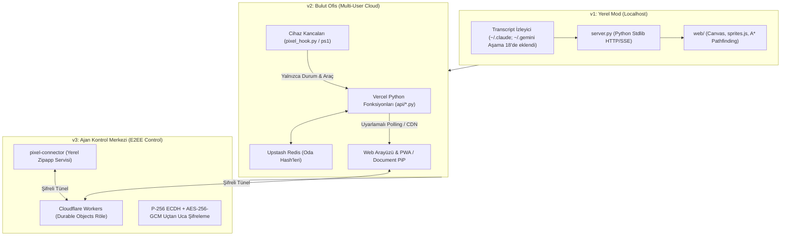

# Pixel Office: Genel Proje Mimarisi, Sistem Tasarımı ve v4 Otonom Çalışma Taslağı

> **Belge Sürümü:** 4.0.0-Draft  
> **Tarih:** 21 Ekim 2026  
> **Durum:** Taslak — kullanıcı onayı bekliyor (Kullanıcı yalnızca A8–A10 geliştirme sırasını onayladı)  
> **Kapsam:** v1 (Yerel Mod), v2 (Bulut Ofis), v3 (Uçtan Uca Şifreli Kumanda) ve v4 (Otonom Çoklu Ajan Taslağı)

---

## 1. Vizyon, Ürün Felsefesi ve Çıkış Noktası

### 1.1 Projenin Yeni Tanımı
Pixel Office, yalnızca arka planda çalışan yapay zekâ oturumlarını izleyen bir "seyir göstergesi" değil; **Yapay Zekâ Çağının Otonom Sanal Çalışma Alanı, Çok Ajanlı Üretim Fabrikası ve Hava Trafik Kontrol Merkezidir (Mission Control & Autonomous Agent Workplace).**

### 1.2 "Heves"ten "Vazgeçilmez İhtiyaç"a Dönüşüm Tezi
Bir aracı "sevimli bir hobi" olmaktan çıkarıp "her gün açılan bir iş aracı" yapan şey **fayda yoğunluğudur (utility density)**:
1. **Görsel Vitrin (Kanca):** Retro piksel estetiği (Gather.town/Habbo tarzı yaşayan ofis), kullanıcıyı ürüne çeker ve karmaşık sistemleri tek bakışta anlaşılır kılar.
2. **Operasyonel Kontrol Kulesi (Ağrı Kesici):** 5-10 farklı terminalde koşan otonom ajanların sağlık durumunu, token maliyetini, döngüye girip girmediğini tek ekrandan denetleme imkânı sunar.
3. **Mekândan Bağımsız Otonomi:** Kullanıcı bilgisayar başından kalktığında (mobil kumanda & sayfa açıkken onay kartları), ajanların güvenle çalışmaya devam etmesini ve kritik kararlarda kullanıcının telefonuna soru sorabilmesini sağlar (sistem düzeyinde Web Push bildirimleri ayrıca planlanabilir).
4. **Otonom İş Devri:** Manuel prompt yazıp bekleme devrini bitirir; tek tıkla elle başlatılan şablonlarla ajanların birbirine iş devrettiği otonom bir akış kurar (bilgisayar açıkken tamamlanan mini MVP şablonu ile başlar).

### 1.3 Temel Tasarım İlkeleri (Değiştirilemez Kurallar)
1. **Yerel-Öncelikli ve Sıfır Bilgi Güvencesi (Local-First & Zero-Knowledge):** Kullanıcının kodu, istemleri, veritabanı kayıtları ve özel anahtarları **kendi bilgisayarından asla çıkmaz**. Bulut sunucuları (Vercel, Cloudflare, Upstash) yalnızca kör sinyal ve şifrelenmiş bayt taşır.
2. **Sıfır Çalışma Zamanı Bağımlılığı (Zero Runtime Dependencies):**
   - Backend: Yalnızca Python standart kütüphanesi (`urllib`, `sqlite3`, `http.server`, `threading`, `secrets`). Ek `pip` paketi kurulmaz.
   - Frontend: Derleme adımı (Webpack, Vite, Tailwind vb.) olmayan saf HTML5, CSS3, Vanilla ES Modülleri ve `<canvas>`.
   - Röle: Cloudflare Workers Builds üzerinde derlenen sıfır çalışma zamanı npm bağımlılığına sahip saf JavaScript.
3. **Sıkı İçerik Güvenliği (Strict CSP):** Harici CDN, uzak Google Font, harici görsel veya izleme kodu yasaktır (`default-src 'self'`). Dinamik metinler daima `textContent` ile basılır, XSS riski sıfırdır.
4. **Hatasızlık ve Test Disiplini:** Her değişiklik tam test takımından (`python3 -m unittest discover -s tests`) sıfır hata ile geçer ve sıfır regresyon hedeflenir.

---

## 2. Mevcut Mimari Temeller (v1, v2 ve v3 Özeti)

Pixel Office, üst üste inşa edilen ve birbirini bozmayan modüler katmanlardan oluşur:



- **v1 (2026-10-11):** Tekil bilgisayarda çalışan, Claude Code transkriptlerini (`~/.claude`) salt-okunur izleyip piksel ofis olarak çizen yerel motor. *(Not: Antigravity `~/.gemini` izleyicisi v1'de yoktu; Aşama 18'de, 2026-10-21'de `web/hook/pixel_antigravity.py` olarak eklendi).*
- **v2 (2026-10-11):** Arkadaşların aynı ofisi izleyebildiği, gizlilik süzgecinden geçmiş olayları Vercel + Upstash üzerinden aktaran PWA.
- **v3 (2026-10-19):** Cloudflare Durable Objects üzerinden çalışan, WebCrypto ve saf Python kripto motoru ile korunan, telefondan komut alıp Claude Code ve Ollama motorlarına ileten kontrol merkezi.

---

## 3. v4 Taslak Mimarisi: Otonom İş Akışı Motoru (Workflow Engine)

v4 ile birlikte Pixel Office, pasif bir izleyiciden **olay-güdümlü bir görev orkestratörüne (Event-Driven Task Orchestrator)** evrilir.

### 3.1 Katmanlı Mimari Şeması

```
┌────────────────────────────────────────────────────────────────────────┐
│ 1. SUNUM KATMANI (Web UI, Mobil PWA, PiP & Ses/Efekt Motoru)           │
│    - Piksel Ofis Haritası (Masalar, Akıllı Tahta, Posta Kutusu)        │
│    - Canlı Görev ve Çıktı Akışı (Markdown-lite, Token Sayacı)          │
│    - Mobil Onay Kartları (Aşama 19: sayfa açıkken çalışan izin/karar)  │
└───────────────────────────────────┬────────────────────────────────────┘
                                    │ (Uçtan Uca Şifreli WebSocket)
┌───────────────────────────────────▼────────────────────────────────────┐
│ 2. GERÇEK ZAMANLI RÖLE (Cloudflare Workers Durable Objects)            │
│    - Zero-Knowledge L1 Çerçeve Taşıyıcısı                              │
│    - Varlık (Presence) ve Hibernation Yönetimi                         │
└───────────────────────────────────┬────────────────────────────────────┘
                                    │ (Uçtan Uca Şifreli L2 Mesajlar)
┌───────────────────────────────────▼────────────────────────────────────┐
│ 3. CİHAZ KONTROL & İŞ AKIŞI MOTORU (pixel_connector / Yerel Süreç)     │
│    ┌───────────────────────────┬──────────────────────────────────┐    │
│    │ WorkflowRunner (DAG)      │ TaskQueue & State Machine        │    │
│    ├───────────────────────────┼──────────────────────────────────┤    │
│    │ ArtifactStore (Yerel Disk)│ FinOps & Anti-Loop Guardrails    │    │
│    ├───────────────────────────┼──────────────────────────────────┤    │
│    │ RemoteApprovalManager     │ SQLite Defteri (Token/Maliyet)   │    │
│    └───────────────────────────┴──────────────────────────────────┘    │
└───────────────────────────────────┬────────────────────────────────────┘
                                    │ (stdin/stdout & CLI Sarmalayıcılar)
┌───────────────────────────────────▼────────────────────────────────────┐
│ 4. AJAN VE ÇALIŞMA ORTAMLARI (Engines & Runtimes)                      │
│    - Claude Code (CLI stream-json, kısıtlı izin profilleri)            │
│    - Antigravity IDE (Aşama 18'de eklenen brain izleyicisi)            │
│    - Ollama (Yerel REST NDJSON API) & OpenAI Uyumlu Yerel Modeller     │
│    - Yardımcı Araçlar: git, pytest, yerel betikler                     │
└────────────────────────────────────────────────────────────────────────┘
```

---

## 4. Fiziksel Ofis Metaforu ile İş Akışları (Visual Spatial Workflows)

Kullanıcının iş akışlarını karmaşık düğüm grafiklerinden (node graphs) kurtarmak için gerçek bir ofisin fiziksel dinamikleri kullanılır:

```
┌───────────────────────────────────────────────────────────────────────┐
│                          PİXEL OFİS v4 KAT PLANI                      │
│                                                                       │
│  [🚪 Çıkış/Teslim]                 [📋 Akıllı Görev Tahtası]           │
│                                                                       │
│  [Masa 1: Mimar]  ───(Yürür)───►  [Masa 2: Kodcu]                     │
│   (Ollama Qwen)                   (Claude Code)                       │
│                                         │                             │
│                                      (Yürür)                          │
│                                         ▼                             │
│  [☕ Kahve Tezgahı]                [Masa 3: Testçi / QA]              │
│                                   (Pytest / Lint)                     │
│                                         │                             │
│  [📬 Gelen Evrak]                   (Aşama 19 Onay Kartı)             │
│   (İleride: Cron/Webhook)               ▼                             │
│                           [👔 Yönetici Masası (Mobil Onay)]           │
└───────────────────────────────────────────────────────────────────────┘
```

1. **Gelen Evrak Kutusu (The Mailbox / İleride Düşünülen Tetikleyiciler):**
   - *Geliştirme Notu:* Kullanıcının sürekli açık bilgisayarı / sunucusu bulunmamaktadır. Bu nedenle GitHub webhook tetikleyicisi veya gece zamanlayıcısı (cron) gibi otomatik tetikleyiciler v4'ün ilk sürümünde değil, ileriki aşamalarda (sunucu/VPS senaryoları) düşünülmektedir. İlk aşamada tüm akışlar kullanıcı tarafından arayüz üzerinden elle başlatılır.
2. **Akıllı Görev Tahtası (Kanban Whiteboard - A8):**
   - Ofis duvarındaki tahtada iş parçaları listelenir: `Sırada`, `Çalışıyor`, `Onay bekliyor`, `Bitti`. Eşleşmemiş/izleyici modunda gizlilik korunur (yalnızca sayılar görünür, görev metni asla yer almaz).
3. **Piksel Animasyonlu Devir-Teslim (The Desk Handoff - A9):**
   - Ajan 1 (Mimar) görevini tamamlayıp spesifikasyonu hazırladığında masadan kalkar, Ajan 2'nin (Geliştirici) masasına doğru yürür. Masaya ulaştığında başlarında bir "evrak" balonu çıkar ve Ajan 2 yazmaya (`working`) başlar. İki adımlı (A → B) zincir ile başlar, döngü engellenir.
4. **Yönetici Masası ve Mobil Onay Durağı (The Boss Checkpoint - Aşama 19):**
   - Kod yazımı bittiğinde veya kritik bir komut çalıştırılacağı zaman ajan durur. Eşleşmiş telefonda / tarayıcıda kontrol sayfası açıkken anlık Aşama 19 onay kartı çıkar (Web Push bildirimi ayrıca planlanabilir):
     > *"Örnek görev için testler geçti. Değişiklik uygulansın mı? [Onayla] [Reddet]"*
   - Kullanıcı onay verene kadar süreç askıda bekler, sıfır token harcanır.
5. **Çıkış Kapısı (The Outbox & Delivery):**
   - Görev onaylandığında ajan kapıya doğru yürür ve iş tamamlanarak teslim edilir (yerel klasöre çıktı yazılır, bildirim güncellenir).

---

## 5. Veri Şemaları ve Protokol Tanımları

İş akışları bağlayıcı içinde deklaratif JSON şemalarıyla yönetilir.

### 5.1 İş Akışı Tanım Şeması (`workflow.json`)

```json
{
  "id": "wf-static-site-v1",
  "name": "Statik Web Sitesi Taslağı",
  "trigger": {
    "type": "manual"
  },
  "guardrails": {
    "maxTotalCostUsd": 2.00,
    "maxTurnsTotal": 10,
    "timeoutSeconds": 900
  },
  "steps": [
    {
      "id": "step-architect",
      "agentKey": "agent-architect",
      "role": "Mimar",
      "engine": "ollama",
      "model": "qwen2.5-coder:7b",
      "promptTemplate": "Şu gereksinim için plan.md mimari planı hazırla: {input.prompt}",
      "outputArtifact": "plan.md"
    },
    {
      "id": "step-developer",
      "agentKey": "agent-developer",
      "role": "Geliştirici",
      "engine": "claude",
      "profile": "edit",
      "inputArtifacts": ["plan.md"],
      "promptTemplate": "plan.md dosyasını oku ve index.html, style.css dosyalarını oluştur.",
      "outputArtifact": "index.html"
    },
    {
      "id": "step-reviewer",
      "agentKey": "agent-qa",
      "role": "İnceleme",
      "engine": "claude",
      "profile": "readonly",
      "inputArtifacts": ["index.html"],
      "promptTemplate": "index.html kodunu incele, güvenlik ve standart uyum raporu yaz.",
      "outputArtifact": "review.md"
    },
    {
      "id": "step-approval",
      "type": "human_checkpoint",
      "title": "Kullanıcı Onayı",
      "previewArtifact": "review.md",
      "timeoutSeconds": 1800,
      "onDeny": "abort"
    }
  ]
}
```

> **Güvenlik ve İzin Notu:** `gh pr create` veya benzeri dış servis etkileşimleri GitHub token'ı gerektirir. Aşama 20 / Paket 1 güvenlik sertleştirmesi gereği ajan çalıştırma ortamına token veya gizli anahtar aktarılmaz. Bu tür eylemler ancak kullanıcının açık onayıyla, adım bazında verilen kısıtlı yetki mekanizması (tasarım aşamasında, henüz mevcut değil) ile yürütülebilir.

### 5.2 Durum Modeli (State Transitions)
Bir iş akışı düğümü şu sonlu durum makinesi (FSM) ile yürütülür:
```
[IDLE] ──► [RUNNING] ──► [WAITING_APPROVAL] ──► [COMPLETED] ──► [NEXT_STEP]
               │                 │
               ▼                 ▼
            [FAILED]          [ABORTED]
```

---

## 6. Güvenlik Kalkanı, FinOps ve Sonsuz Döngü Koruması

Ajanların otonom çalışması sırasında kontrolden çıkmasını engelleyen güvenlik mekanizmaları zorunludur:

### 6.1 Harcama Tavanı (Cost Hard-Cap)
- Her iş akışının mutlak bir **Maksimum Maliyet Limiti** (örneğin görev başına $2.00) vardır.
- Claude Code'un `modelUsage` farkları adım adım SQLite defterine yazılır. Tavan değere ulaşıldığı anda bağlayıcı sürece `SIGINT` → `SIGTERM` göndererek işi güvenle durdurur.

### 6.2 Adım Sayacı (Anti-Infinite Loop)
- Ajanların kendi aralarında birbirini sonsuza kadar tetiklemesini önlemek için adım sayısı sınırlandırılmıştır (Varsayılan max: 6 tur, devirde max 1 adım A → B).
- Aynı dosya üzerinde peş peşe başarısız deneme yapan ajan otomatik olarak **Yönetici Masasına (Mobil Onay)** yönlendirilir.

### 6.3 İzin Listesi İzolasyonu (Workspace Guardrails)
- Aşama 16 ve Aşama 20 siber güvenlik denetiminde konulan kurallar ([`docs/SECURITY_AUDIT.md`](SECURITY_AUDIT.md)) aynen geçerlidir:
  - `.git/config`, `~/.ssh`, `~/.claude`, `.env`, kabuk başlangıç dosyaları (`.bashrc`) ve kök sistem dizinleri **kesinlikle değiştirilemez ve okunamaz**.
  - İş akışları yalnızca izin verilen `~/PixelOfficeIsler/` veya onaylanmış çalışma klasörlerinde çalışır.

### 6.4 Gizli Bilgi ve Dış Servis İzolasyonu (Tokens & Secrets Isolation)
- Aşama 20 / Paket 1 sertleştirmesi (`docs/SECURITY_AUDIT.md` §8) uyarınca, ajan çalıştırma ortamlarına (`child_env`) API token'ları, GitHub anahtarları (`GITHUB_TOKEN`, `GH_TOKEN`), SSH kimlik bilgileri veya gizli ortam değişkenleri **asla aktarılmaz**.
- Dış dünyaya komut gönderecek adımlar genel ajan izinlerine bağlanamaz; "kullanıcının açık onayıyla, adım bazında verilen kısıtlı geçici yetki" mekanizması tasarlanmadan otomatik PR veya harici token gerektiren işlemler yapılamaz.

---

## 7. Şablon Yaklaşımı ve İlk MVP Şablonu

> **Önemli Kısıt:** Kullanıcının sürekli açık bilgisayarı / sunucusu yoktur. Bu nedenle Gece Nöbetçisi gibi gece boyu koşan şablonlar ve arka plan webhook tetikleyicileri "İleride Düşünülen Şablonlar" bölümüne alınmıştır. İlk odak (A10), kullanıcının bilgisayarı açıkken elle başlattığı ve makul sürede tamamlanan iş akışlarıdır.

### 7.1 İlk Odak Şablon (A10 Kapsamı — Bilgisayar Açıkken Biten Akış)
**Şablon: Statik Site / Dokümantasyon Taslağı (Mimar → Kodcu → İnceleme → Onay)**
- **Kullanım Amacı:** Kullanıcı bilgisayar başındayken `~/PixelOfficeIsler` içinde tek tıkla küçük bir statik web sitesi ya da dokümantasyon taslağı üretir.
- **İş Akışı:**
  1. Mimar (Ollama): Sayfa mimarisini ve gereksinimleri çıkarır (`plan.md`).
  2. Geliştirici (Claude Code, edit profili): HTML/CSS/JS kodlarını yazar.
  3. İnceleme / QA (Claude Code, readonly profili): Kod kalitesini ve standart uyumunu inceler (`review.md`).
  4. Yönetici Masası (Aşama 19 Onay): Kullanıcı tarayıcıda / telefonda açık arayüzden inceler ve onaylar.
- **Kullanıcı Değeri:** Bilgisayar başında dakikalar içinde çalışan, güvenli ve insan kontrollü bir taslak elde edilir; sürekli açık makine gerektirmez.

### 7.2 İleride Düşünülen Şablonlar (Sürekli Açık Makine / VPS Gerektirenler)
- **Şablon A: Otonom Gece Nöbetçisi (The Night Shift):** Gece açık bırakılan bir makinede veya VPS üzerinde açık bug'ları tarama ve çözüm denemesi.
- **Şablon B: Sıfır Maliyetli İçerik Fabrikası (Repo → Blog & Video Taslağı):** Yeni etiketlerde sürüm notu, `edge-tts` ile nöral ses ve `ffmpeg` ile taslak video montajı (bkz. §9 Riskler).

---

## 8. Ürünleştirme, Ticarileştirme ve Fiyatlandırma Taslağı

```
┌────────────────────────────────────────────────────────────────────────┐
│                        TİCARİLEŞTİRME KATMANLARI                       │
├───────────────────┬───────────────────┬────────────────────────────────┤
│ FREE / COMMUNITY  │ PRO DEVELOPER     │ TEAM & AGENCY                  │
│ (Ücretsiz)        │ ($15 / ay)        │ ($79 / ay)                     │
├───────────────────┼───────────────────┼────────────────────────────────┤
│ • Yerel Mod       │ • Sınırsız Mobil  │ • 10 Kişilik Ortak Sanal Ofis  │
│ • Temel Bulut     │   Kumanda         │ • Çoklu Ajan Kanban Panosu     │
│ • Tekil Ajan      │ • Canlı Onay      │ • GitHub/Linear İki Yönlü Senk │
│ • Manuel Prompt   │   Kartları        │ • FinOps ve Müşteri Bazlı      │
│   (İzleme amaçlı) │   (Aşama 19)      │   Maliyet Faturalandırma       │
│                   │ • İki Adımlı      │ • Şirket İçi GPU Sunucu Odası  │
│                   │   Devir Akışları  │   (vLLM/Ollama Cluster Bağlantı│
│                   │ • Webhook / Bot   │ • Değiştirilemez Denetim Logu  │
│                   │   Köprüsü (İleri) │                                │
└───────────────────┴───────────────────┴────────────────────────────────┘
```

---

## 9. Riskler ve Yasal / Teknik Kısıtlamalar

A4 otomasyon araştırmasında ve Aşama 20 güvenlik analizinde tespit edilen riskler:

1. **`edge-tts` Bağımlılık Riski:**
   - `edge-tts`, Microsoft Edge'in resmî olmayan, belgelenmemiş bir konuşma sentezi uç noktasını kullanır.
   - Microsoft her an bu uç noktayı kapatabilir, kimlik doğrulamaya bağlayabilir veya hız sınırı (rate limit) uygulayabilir. Üretim ortamında resmî bir SLA güvencesi yoktur.
2. **Claude Aboneliği ve Anthropic Kullanım Şartları (ToS):**
   - Kullanıcıların kişisel Claude Pro/Team abonelikleri üzerinden arka planda otomatik, ticari veya çok kullanıcılı servis sunulması Anthropic Kullanım Şartları açısından dikkatle incelenmelidir.
   - Ticari SaaS / çok kullanıcılı ürünleşmede resmi Anthropic API anahtarı kullanımı ile kişisel Claude Code CLI kullanımı kesin çizgilerle ayrılmalıdır.
3. **YouTube ve Dış Servis API Kotaları:**
   - YouTube Data API v3 günlük kota sınırlarına tabidir ve video yükleme denetimden (audit) geçmeyi gerektirir.
4. **Sürekli Açık Makine Kısıtı:**
   - Kullanıcıların yerel makineleri uyku moduna geçebilir ya da kapatılabilir; arka plan zamanlayıcıları ve webhook'lar yerel modda kesintisiz çalışamaz.

---

## 10. v4 Geliştirme Yol Haritası (Onaylanan Sıra)

Kullanıcı tarafından `docs/V4_ANTIGRAVITY.md` kapsamında onaylanan geliştirme sırası:

1. **Aşama 19 (Claude):** Telefondan `allow/deny` mobil onay mekanizmasının tamamlanması (sayfa açıkken).
2. **A8 (Antigravity):** v4-A — Ofis duvarında Görev Tahtası (Kanban Whiteboard; `Sırada`, `Çalışıyor`, `Onay bekliyor`, `Bitti`).
3. **A9 (Antigravity):** v4-B — Masadan masaya devir (Ajan A bittiğinde çıktıyı Ajan B'ye aktarma ve yürüyüş animasyonu).
4. **A10 (Antigravity):** v4-C — İş akışı motoru (`workflows.py`) ve ilk yerel şablon (Mimar → Kodcu → İnceleme → Onay).

---
*Bu belge, Pixel Office v4 özellikleri için hazırlanmış taslak bir sistem tasarımı ve tartışma dokümanıdır; kullanıcı onayı beklemektedir (yalnızca A8–A10 geliştirme sırası onaylanmıştır).*
