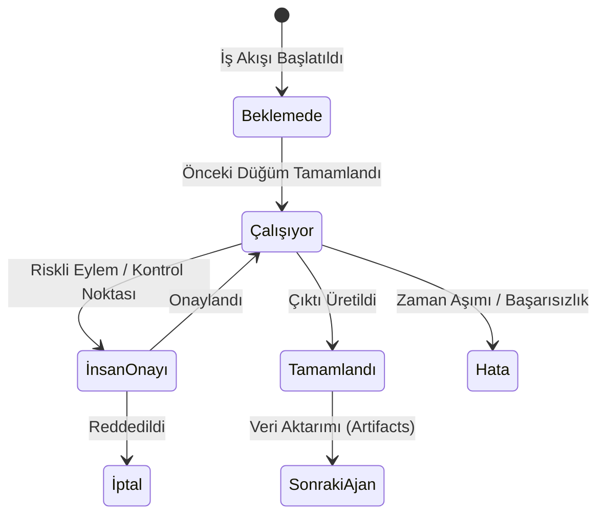

# Pixel Office v4: Otomasyon Şablonları ve Çok Ajanlı İş Akışları Ön Araştırması

> **Tarih:** 19 Ekim 2026  
> **Hazırlayan:** Antigravity (Advanced Agentic AI)  
> **Durum:** v4 Mimarisi Ön Fizibilite ve Tasarım Raporu  
> **Bağlantılı Belgeler:** [`PROJECT.md`](../PROJECT.md), [`docs/V3.md`](V3.md), [`docs/ARCHITECTURE.md`](ARCHITECTURE.md)

---

## 1. Yönetici Özeti ve Vizyon

Pixel Office v1–v3 sürümleriyle birlikte; yapay zekâ kodlama ajanlarını tek bakışta izlenebilir kılan, Document PiP ve PWA ile her ekranda yaşayabilen ve v3 ile Cloudflare Durable Objects + P-256 uçtan uca şifreleme üzerinden telefondan kumanda edilebilen güvenli bir kontrol merkezine dönüştü.

**v4'ün Hedefi:**  
Ajanları sadece tekil görevlerle çalıştırmak yerine; kodsuz (no-code) bir kullanıcının dahi tek tıkla başlatabileceği **"Otomasyon Şablonları"** ile çok ajanlı işbirlikçi iş akışlarını hayata geçirmektir. Kullanıcı "Web Sitesi Yap", "GitHub PR Düzelt" veya "Video → YouTube" gibi bir şablon seçecek; ofisteki piksel çalışanlar işi birbirine devredecek (örneğin Tasarımcı bitirince Frontend masasına yürüyecek, Frontend bitince QA masasına devredecek), kullanıcı telefonundan kritik anlarda onay verecektir.

---

## 2. Otomasyon Şablon Fikirleri (9 Adet)

Aşağıdaki şablonlar karmaşıklık, maliyet ve uygulanabilirlik açısından derecelendirilmiştir.

| # | Şablon Adı | Ajan Sayısı & Rolleri | Önerilen Motorlar | Dış Servisler | Zorluk | Maliyet / Çalıştırma |
|---|---|---|---|---|---|---|
| **1** | **Full-Stack Web Sitesi** | 3 (Mimar, Frontend, Backend) | Claude Code (Frontend/Backend) + Ollama (Mimar) | Yok (Yerel dosya) | Orta | ~$0.15 – $0.40 |
| **2** | **GitHub PR İnceleme & Test Düzeltme** | 2 (İnceleyici, Tamirci) | Claude Code (Tamirci) + Ollama (İnceleyici) | GitHub CLI (`gh`) | Düşük-Orta | ~$0.10 – $0.25 |
| **3** | **Teknik Blog & Çok Kanallı İçerik** | 2 (Araştırmacı/Yazar, Sosyal Medyacı) | Ollama (Llama/Qwen) veya Claude Code | Opsiyonel: Dev.to / Hashnode API | Düşük | $0.00 (Yerel) veya ~$0.05 |
| **4** | **Video Script → TTS → Render → YouTube** | 3 (Senarist, Ses/Görselci, Yayıncı) | Claude Code (Script) + Python Scriptleri | Edge-TTS, FFmpeg, YouTube Data API | Yüksek | ~$0.05 + API Kotası |
| **5** | **Otomatik Bug Hunter & Fixer** | 2 (Hata Dedektifi, Test Mühendisi) | Claude Code | Yerel test ortamı (pytest/unittest) | Orta | ~$0.15 – $0.35 |
| **6** | **Veri Analizi & Günlük PDF Raporu** | 2 (Veri Analisti, Görselleştirici) | Ollama (Yerel) + Python (pandas/matplotlib) | E-posta SMTP / Telegram Bot | Düşük-Orta | $0.00 (Yerel) |
| **7** | **Müşteri Destek / Gelen Kutu Özeti** | 1-2 (Tasnifçi, Taslak Yazarı) | Ollama (Qwen2.5/Llama-3) | IMAP/SMTP veya Slack Webhook | Düşük | $0.00 (Yerel gizlilik) |
| **8** | **Rakip Fiyat & Pazar Takipçisi** | 2 (Web Scraper, İstatistikçi) | Python Scraper + Ollama | Hedef e-ticaret sayfaları | Orta | $0.00 |
| **9** | **Mikro SaaS MVP İskeleti** | 4 (Ürün Müdürü, DB Mimarı, API, UI) | Claude Code | SQLite, Tailwind/HTML, Git | Yüksek | ~$0.40 – $0.90 |

---

### Şablon Detayları

#### Şablon 1: Full-Stack Web Sitesi (MVP Üretici)
- **Akış:**
  1. *Ürün Mimarı (Ollama):* Kullanıcı istemini (`"Online kahve sipariş sitesi"`) alır, sayfa yapısını ve bileşen listesini (`spec.json`) çıkarır.
  2. *Frontend Ajanı (Claude Code):* HTML/CSS/JS kodunu yazar, responsive tasarımı tamamlar.
  3. *Backend/API Ajanı (Claude Code):* Gerekli mock veritabanı veya API uçlarını oluşturur.
  4. *İnsan Onayı (Telefon):* Tarayıcıda ekran görüntüsü kullanıcıya gönderilir; kullanıcı "Onayla" derse iş biter.

#### Şablon 2: GitHub PR İnceleme & Test Onarımı
- **Akış:**
  1. *İnceleyici (Ollama):* `gh pr diff` çıktısını okur, kod standartları ve olası mantık hatalarını raporlar.
  2. *Tamirci (Claude Code):* `pytest` veya test komutunu çalıştırır. Test patlarsa ilgili dosyayı düzenler, testi tekrar koşar.
  3. Testler yeşil olunca commit atar ve PR'a yorum yazar.

#### Şablon 4: Video Script → Render → YouTube Yükleme
- **Akış:**
  1. *Senarist (Claude Code):* Konu başlığına göre 60 saniyelik YouTube Shorts metni ve sahne promptları üretir.
  2. *Kurgucu (Python stdlib/FFmpeg + Edge-TTS):* Metni ücretsiz yerel TTS ile seslendirir, arka plan videosunu kırpar, altyazıları ekler ve `.mp4` üretir.
  3. *İnsan Onayı (Zorunlu):* Telefondaki Pixel Office bildiriminde videonun önizlemesi sunulur. Kullanıcı onaylamadan hiçbir video yüklenemez.
  4. *Yayıncı:* YouTube Data API v3 ile videoyu `private` veya `unlisted` olarak yükler.

---

## 3. Ajanlar Arası Devir Teslim Modeli & v3 Mimarisine Uyumu

### 3.1 Durum Makinesi ve Mesajlaşma (DAG - Directed Acyclic Graph)
İş akışları sıralı (linear) veya dallanan (DAG) adımlardan oluşur. Her adım bir **Görev Düğümü** (Task Node) olarak temsil edilir:

### 3.2 Mevcut v3 Protokolüne (`docs/V3.md`) Entegrasyon
Pixel Office v3 mimarisi, güvenliği ve uçtan uca şifrelemeyi en üst düzeyde tutacak şekilde tasarlanmıştır. v4 otomasyonları bu çekirdeği **bozmadan** üst katmana yerleşir:
1. **Röle Düzeyi:** Röle hiçbir iş akışı mantığını bilmez. Röle yalnızca şifreli L2 paketlerini taşımaya devam eder.
2. **Cihaz Düzeyi (`pixel_connector`):** Bağlayıcıya `workflows/` yöneticisi eklenir. Görevler arasındaki çıktı dosyaları (`artifacts/`) yerel diskte güvenli çalışma klasöründe (`~/PixelOfficeIsler/workflows/<id>/`) saklanır.
3. **Ofiste Görsel Animasyon:**
   - Ajan 1 (ör. Tasarımcı) görevini bitirdiğinde, kahve makinesine gitmek yerine ofis haritasında Ajan 2'nin masasına doğru yürür.
   - Masaya ulaştığında küçük bir "evrak/dosya" teslim ikonu belirir.
   - Ajan 2 masasında yazmaya (`working`) başlar. Bu, otomasyonu izleyen kullanıcı için benzersiz bir görsel tatmin sağlar.

### 3.3 İnsan Onay Noktaları (Human-in-the-Loop)
- Belirli adımlar "onay gerektirir" olarak işaretlenir (ör. para harcama, dış dünyaya commit atma, video yükleme).
- Kullanıcının telefonundaki PWA arayüzünde bildirim ve "Onayla / Reddet" butonları belirir.
- Onay verilene kadar motor donar (hibernation), kota ve token harcanmaz.

---

## 4. Rakip Analizi: Pixel Office Nerede Konumlanıyor?

| Kriter | n8n / Zapier / Make | CrewAI / AutoGen | Lindy AI | **Pixel Office (v4)** |
|---|---|---|---|---|
| **Kullanıcı Kitlesi** | Teknik Operasyon & Entegrasyoncular | Python Yazılımcıları & Veri Bilimciler | İş Dünyası, Yönetici Asistanlığı | Geliştiriciler, Bireysel Üreticiler & Ekipler |
| **Görselleştirme** | Düğüm/Kutu akış şeması (Node-graph) | Yok (Terminal / Ham loglar) | Slack / Web Chat penceresi | **Yaşayan Pixel-Art Sanal Ofis 🖥️** |
| **Çalışma Alanı** | Bulut Sunucuları (SaaS) | Yerel kod betikleri | Lindy Bulut Altyapısı | **Kullanıcının Kendi Bilgisayarı (Localhost Sandbox)** |
| **Güvenlik & Gizlilik** | Kod ve veriler buluta taşınır | Geliştiriciye bağlı | Üçüncü taraf bulutta işlenir | **Uçtan Uca Şifreli (E2E), Sıfır Kod Sızıntısı** |
| **Model Özgürlüğü** | API Anahtarı şart | API / Yerel (Kodlama gerektirir) | Kapalı tescilli modeller | **Claude Code CLI + Ollama + LM Studio Hibrit** |
| **Mobil Denetim** | Zayıf mobil web | Yok | Chat botu üzerinden | **Tam Teşekküllü PWA + Canlı Görev Paneli** |

> **Pixel Office'in Farkı:** n8n gibi araçlar karmaşık düğüm kablolarıyla boğuşmayı gerektirirken, CrewAI geliştirici düzeyinde Python kodu ister. Pixel Office ise **sıfır konfigürasyonla çalışan, retro oyun estetiğinde izlenen, verilerin cihazdan asla çıkmadığı ve telefondan tek dokunuşla yönetilen** dünyadaki tek platformdur.

---

## 5. Risk Analizi ve Hukuki/Teknik Sınırlar

### 5.1 YouTube Data API v3 Kısıtları ve Kotası (Kaynak: Google Developers 2026)
- **Kota Yapısı:** `videos.insert` çağrısı artık genel havuz yerine izole kota sepetinde çalışır. Doğrulanmamış (unverified) projeler için günlük tavan **100 video yüklemesidir** (her çağrı 1 birim).
- **Gizlilik Durumu:** Geliştirme ve test aşamasında yüklemeler daima `private` ya da `unlisted` yapılmalıdır.
- **Doğrulama (Audit) Zorunluluğu:** Projeyi genel kullanıma açmak veya kotayı artırmak için Google'ın **YouTube API Services Audit** incelemesinden geçmek zorunludur.
- **Token Geçerliliği:** Doğrulanmamış projelerde hassas kapsamlar (`youtube.upload`) için refresh token 7 günde bir düşer.
- **Karar:** v4'te YouTube entegrasyonu varsayılan olarak `private` yükleme yapmalı ve kullanıcının kendi OAuth kimlik bilgileriyle çalışmalıdır.

### 5.2 Video Üretim & Render Maliyetleri
- Bulut API'leri (Runway, Sora, HeyGen vb.) video başına $0.20 – $2.00 arasında maliyet çıkarır. Bu, ücretsiz deneme felsefesine uymaz.
- **Çözüm:** Video şablonu yerel kaynakları kullanmalıdır:
  - Ses: `edge-tts` (Microsoft Edge çevrimiçi nöral sesleri, ücretsiz ve yüksek kaliteli Türkçe destekli).
  - Görsel/Video: Yerel FFmpeg + telifsiz stok kütüphaneleri (Pexels API - ücretsiz) veya basit görsel slayt geçişleri.
  - Render: Kullanıcının yerel CPU/GPU'su üzerinde FFmpeg ile 10-15 saniyede tamamlanır (maliyet $0).

### 5.3 Anthropic Kullanım Koşulları ve Claude Code Sınırları (Kaynak: Anthropic 2026)
- **Tüketici Aboneliği Kuralı:** Anthropic Consumer Terms (Pro/Max), kullanıcının kendi makinesinde resmi, değiştirilmemiş `claude` ikili dosyasını `-p` ile çalıştırmasına ve kişisel betiklerine izin verir.
- **Yasak Olan:** Kullanıcının tüketici aboneliğini üçüncü kişilere çok kiracılı (multi-tenant) bir SaaS altyapısı olarak satmak veya 7/24 kesintisiz kurumsal üretim sunucusu gibi sömürmek yasaktır.
- **v4 Tasarım Uyumu:** Pixel Office v4'te iş akışları **tamamen kullanıcının kendi bilgisayarında, kendi aboneliğiyle ve tekil olarak** çalışır. Şirketleşme/Girişim aşamasına gelindiğinde kurumsal kullanıcılar için doğrudan Anthropic API anahtarı moduna geçiş mimaride zaten hazırdır.

---

## 6. Önerilen İlk 3 Şablon (MVP) ve Yol Haritası

İlk aşamada karmaşık dış API'lere bağımlı olmayan, kullanıcıya anında değer üreten 3 temel şablon seçilmiştir:

### 1. Full-Stack Mini Web Sitesi (Tasarımcı → Geliştirici → Testçi)
- **Neden İlk?** Sıfır dış servis bağımlılığı. Tamamen yerel dosya sistemi üzerinde çalışır. Kullanıcı sonucunu tarayıcıda hemen görür.

### 2. GitHub PR İnceleme & Test Düzeltici
- **Neden İkinci?** Yazılımcılar için devasa bir zaman tasarrufu. `gh` CLI ile kusursuz entegrasyon. Hata yapma riski sıfıra yakın.

### 3. Teknik Blog & Dokümantasyon Üretici
- **Neden Üçüncü?** Bir depoyu tarayıp README, CHANGELOG, API referansı veya Medium/Dev.to blog yazısı taslağı hazırlar. Tamamen yerel Ollama ile dahi sıfır maliyetle çalışabilir.

---

## 7. Sonuç ve Sonraki Adımlar

Pixel Office v4 Otomasyon Mimarisi:
1. v3'ün güvenli, uçtan uca şifreli ve yerel-öncelikli felsefesini korur.
2. Kullanıcılara karmaşık kodlama işlerini birkaç tıkla orkestre etme gücü verir.
3. Ofisteki sevimli pixel karakterlerin işbirliğini somutlaştırarak piyasadaki tüm rakiplerinden görsel ve deneyimsel olarak ayrışır.

Bu rapor, kullanıcı ve mimar onayının ardından v4 geliştirme aşamasında doğrudan uygulanabilir bir rehber niteliğindedir.
